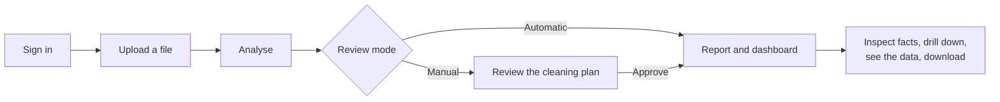
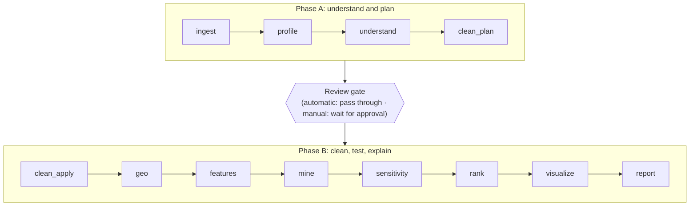
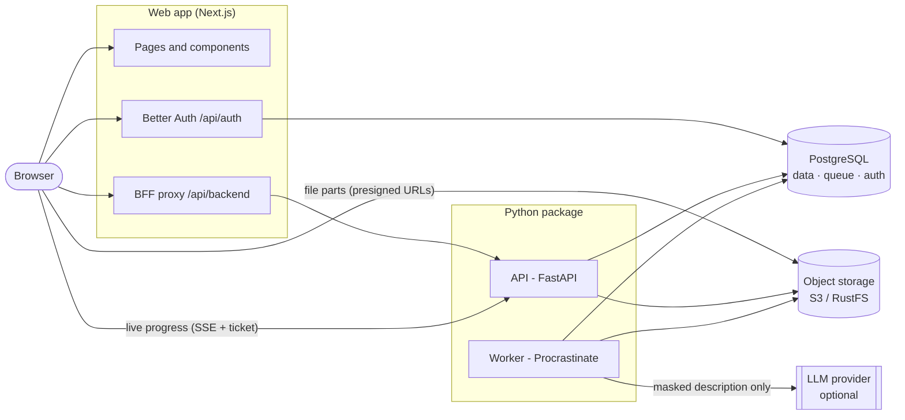

# InsightfulCell

**Upload a table. Get a cleaned dataset, tested findings and a plain-language report in which every number shows its work.**

InsightfulCell is a web platform for analysing your own data without a statistics background and without trusting a black box. You upload a spreadsheet (CSV, TSV, Excel, Parquet or JSON). It reviews and cleans the data with you, tests every question with proper statistics, and writes a report, a dashboard and checked charts and maps. Every figure links back to a stored, unchangeable fact, so you can always see where it came from. Your raw rows are never sent to an AI model.

> **Status:** release 0.6.0. Phases 1–6 of 8 are built and tested: sign-in, uploads, the analysis pipeline, narration, and the report and dashboard. Phase 7 (asking questions about your data) and Phase 8 (production operations) are next. See [Project status and roadmap](#project-status-and-roadmap).

---

## Contents

1. [Overview](#overview)
2. [Features](#features)
3. [How it works](#how-it-works)
4. [Architecture](#architecture)
5. [Backend concepts](#backend-concepts)
6. [Frontend concepts](#frontend-concepts)
7. [Getting started](#getting-started)
8. [Configuration](#configuration)
9. [Development workflow](#development-workflow)
10. [Project structure](#project-structure)
11. [API reference](#api-reference)
12. [Security and privacy](#security-and-privacy)
13. [Project status and roadmap](#project-status-and-roadmap)
14. [Known limitations](#known-limitations)
15. [Team and contributions](#team-and-contributions)
16. [Documentation](#documentation)
17. [Licence](#licence)

---

## Overview

### The idea

People with a spreadsheet want answers, not a statistics course. The tools available today make them choose between two bad options:

- **General-purpose AI assistants** give fluent analyses, but their numbers can be made up, their data cleaning is invisible, and sending raw rows to a model is unacceptable for sensitive data.
- **Traditional BI and statistics tools** are accurate, but need a skilled analyst to prepare the data and to know which questions to ask.

InsightfulCell started from one question: *can an analysis be as easy as asking an assistant, and as trustworthy as one done by a careful analyst?* The answer it builds towards is a clear division of labour:

- **Code computes**: every statistic, test, chart value and map value is calculated by deterministic code.
- **A language model only plans and writes**: it proposes which questions to ask and turns verified facts into sentences.
- **Everything is checked**: plans are validated, numbers are filled in by the engine (the model cannot write a number), and every sentence and chart is verified against its sources before anyone sees it.

### The product vision

> Upload a CSV → reviewed cleaning → signal-gated features → statistically controlled insight mining → verified, narrated report → grounded Q&A. **Every number shown to a user must trace to an immutable fact.**

### What it does

1. **Reads your file safely.** It checks the bytes, parses them in the background worker under strict limits, works out what each column means (amount, category, date, place, identifier…), and flags personal data such as names, emails and phone numbers.
2. **Proposes a cleaning plan.** It suggests typed changes (fix types, unify spellings, handle placeholders, remove duplicates…), each marked as lossless or as one that can remove data, and shows exactly how many rows each change affects. You can accept it automatically or review every change yourself.
3. **Finds what is real.** It tests relationships, differences and trends with proper statistics and controls the share of false findings across the whole analysis. It then re-tests the strongest findings on less-cleaned data, to make sure the cleaning did not create them.
4. **Explains it.** It writes a report and builds a dashboard in plain language. Every sentence cites its facts, every chart and map value is recomputed before display, and the report downloads as PDF, Word, Markdown or HTML.
5. **Lets you dig in.** You can open the evidence behind any number, explore one group on its own (a drill-down), and look at the original rows in a side panel next to the findings.

### What makes it different (the tenets)

When two goals conflict, the higher one wins:

| # | Tenet | What it means in the product |
|---|---|---|
| 1 | **Correctness over fluency** | Statistics come from code; false discoveries are controlled across the run; charts are recomputed; sentences are verified. |
| 2 | **Traceability** | Facts are append-only and hashed; sentences and chart points cite fact ids; plans and decisions are versioned. |
| 3 | **Privacy: raw rows never reach a model** | A model sees only a masked description of the table; personal data is detected first; a gateway blocks any payload containing it. |
| 4 | **Simplicity of operation** | One modular codebase; PostgreSQL is also the job queue; no new infrastructure without a recorded decision. |

### Who it is for

| User | What they do |
|---|---|
| **Analyst** (owner, admin, analyst roles) | Upload, run analyses, review cleaning, read and explore results |
| **Viewer** | Read reports and dashboards others produced (role exists; invitations UI not built yet) |
| **Organisation owner/admin** | Members, cleaning policy and spending (partly built) |

---

## Features

**Sign-in and workspaces**
- Email and password registration and sign-in, optional Google sign-in, and email sign-in links (built, off until a mail domain is verified).
- Every user gets an organisation (workspace); data never crosses organisations.

**Uploads**
- CSV, TSV, Excel (`.xlsx`), Parquet and JSON / JSON Lines, up to 250 MB.
- The browser hashes the file (SHA-256, in a Web Worker) and uploads it straight to object storage in parallel parts, with retries and resume.
- The same file uploaded twice is stored once, and you are told so.

**Analysis**
- Live progress for every step, streamed to the browser, with cancel and retry from the last checkpoint.
- **Automatic** mode (default): applies the suggested cleaning and goes straight to the report.
- **Manual** mode: stops for your review. Apply or keep each change, see exactly what a model would be sent, ask for a different plan in your own words, then approve.
- A downloadable Python recipe rebuilds the cleaned table outside the app.

**Results**
- **Report:** answers per question, each with its sources, a summary written last from verified findings, and an "In short" section.
- **Dashboard:** headline numbers, top charts, maps of places, and suggested questions already answered.
- **Fact inspector:** behind every citation, the test, interval, p and q values, rows used and how it was computed.
- **Checked charts and maps:** a chart with any mismatch is withheld rather than shown wrong.
- **Downloads:** PDF, Word, Markdown and a self-contained HTML file.
- **Drill-downs:** explore one group (for example one region) as an exploratory sub-run.
- **See the data:** a resizable side panel with the original rows (personal-data columns stay hidden).
- **Delete:** remove an analysis or a whole dataset at once; files leave storage after a grace period.

---

## How it works

### The user's journey



### The analysis pipeline

An analysis is a **run**: one analysis of one dataset version. It runs as two jobs on a queue, split at the review gate. Each stage is checkpointed, so a retry resumes where it stopped.



| Stage | What it does |
|---|---|
| `ingest` | Re-hashes the stored bytes (must match the upload), parses the file under strict limits into typed Parquet, assigns each column a meaning and flags personal data. |
| `profile` | Per-column statistics, missing-value patterns, duplicates and outliers. |
| `understand` | Builds the analysis plan (which questions to ask) from a model, or from the built-in rules, and validates it item by item. |
| `clean_plan` | Proposes typed cleaning operations, each lossless or lossy, measured on every row. |
| `clean_apply` | Applies the approved cleaning; also keeps a lossless-only copy for the sensitivity check. |
| `geo` | Resolves places (suburbs, states, postcodes, coordinates) to standard regions using a packaged, digest-pinned reference set. |
| `features` | Keeps derived measures only if they carry signal (they must beat 19 random shuffles). |
| `mine` | Nine miners test the plan's questions; every test is logged; false discoveries are controlled at 5% across the whole run (Benjamini-Hochberg). |
| `sensitivity` | Re-tests the top ten findings on the lossless-only data. |
| `rank` | Orders findings by strength and relevance. |
| `visualize` | Builds charts and maps; every point is a claim recomputed by its own query. |
| `report` | Narrates each question from its facts, verifies every sentence and assembles the report and dashboard. |

### How a sentence gets written

1. The engine stores each finding as a **fact**: numbers, test, interval, p and q values, tier, provenance and a content hash. Facts are append-only.
2. A model (or a template) writes sentences with **numeric slots** such as `{F3.1}`. The engine fills them from the fact, so a model cannot write a wrong number.
3. A **verifier** checks every sentence: citations, stray numbers, direction, strength words against effect sizes, causal language and missing conditions. A failed sentence is rewritten once, then replaced by the fact's own statement.
4. The summary is written last, from verified findings only. If the model is unavailable, the report is "simplified" (template sentences) and can be narrated again later.

---

## Architecture

InsightfulCell is a **modular monolith** shipped as three processes: a **web app**, an **API** and a **worker**. The API and worker are the same Python package with different entry points. They share one PostgreSQL database and one S3-compatible object store.



The browser talks only to the web app, with two direct paths for heavy traffic. File bytes go straight to object storage through presigned URLs, and progress streams straight from the API with a ticket for one run. When the whole stack runs on one machine and is opened from another address (a tunnel), the web app relays both paths too (see [Sharing a local copy](#sharing-a-local-copy-ngrok)).

### Technology stack

| Layer | Choice | Why |
|---|---|---|
| Web | Next.js 16 (App Router), React 19, TypeScript (strict), Tailwind CSS 4 | Server rendering; the API token never reaches the browser |
| Sign-in | Better Auth 1.7 (organisation + JWT plugins), Ed25519 keys | Organisations and roles in our own database |
| API | FastAPI, Pydantic 2, SQLAlchemy 2 (async), psycopg 3 | Same language as the engine; async streaming; generated types |
| Queue | Procrastinate on PostgreSQL | Jobs and run state in one database |
| Database | PostgreSQL 18 (row-level security, JSONB, full text, LISTEN/NOTIFY, partitions) | One system to secure, back up and isolate tenants in |
| Files | S3 API (RustFS locally, S3 in production) | Bytes go to the service built for them |
| Parsing and statistics | DuckDB, NumPy, SciPy, scikit-learn, RapidFuzz, Shapely | Fast in-process parsing; proven statistics |
| Models | One gateway; Gemini (default), OpenAI, Anthropic, DeepSeek; rules fallback | Budgets, privacy checks and accounting in one place |
| Exports | Jinja2 HTML, python-docx, fpdf2, resvg | Self-contained files, no browser needed in the worker |
| Testing | pytest, Vitest + Testing Library + axe, Playwright | Unit to browser coverage |

---

## Backend concepts

The backend lives in `backend/src/insightfulcell/` (Python 3.13, managed with [uv](https://docs.astral.sh/uv/)).

### Layers

Dependencies point one way, and `import-linter` enforces it in CI (six contracts), not convention:

```
domain  ←  ingestion, storage, auth  ←  db  ←  services  ←  api
                    engine and pipeline (pure: no database, storage, web or model SDKs)
```

| Package | Responsibility |
|---|---|
| `domain` | Pure rules with no I/O: run states and transitions, roles and permissions, error types. |
| `ingestion` | File formats, limits and safe parsing into Parquet. |
| `storage` | The object-store port and its S3 adapter (presigned URLs, multipart uploads). |
| `auth` | Token verification against the web app's published public keys. |
| `db` | SQLAlchemy models, engine, and the tenant transaction that sets the organisation. |
| `services` | Use cases: uploads, datasets, runs, plans, reports, data rows, drill-downs, deletion, the run executor and maintenance. |
| `api` | FastAPI app, routers, schemas, middleware and problem responses. |
| `engine` | The pure analysis engine: semantics, profiling, schema card, planning, cleaning, analysis, geo. |
| `pipeline` | Stage wrappers and checkpoints around the engine. |
| `llm` | The model gateway, providers, prompts and pricing. |
| `queue`, `worker` | The Procrastinate adapter and the worker entry point. |
| `exports` | Report rendering to HTML, Markdown, Word and PDF. |

### Identity, tokens and tenancy

- **Who you are** is decided by the web app (Better Auth). For each API call, the web server mints a **15-minute EdDSA token**. The API verifies it offline against the published keys, with the algorithm pinned to EdDSA, and issuer, audience and expiry checked.
- **Which organisation** comes only from the verified token, never from a request body.
- **Every tenant query** runs inside `TenantDatabase.transaction(principal)`. It sets `app.org_id` for that transaction only, and every tenant table has **forced row-level security** keyed on it. Composite foreign keys stop a row from pointing across organisations, and the API connects as a role that cannot bypass RLS.
- **Permissions** are one table of role × action in `domain/security.py` (for example, viewers can read runs but not start them).

### API conventions

- **Errors** follow RFC 9457 problem details, built from `DomainError` subclasses (`code`, `title`, `detail`, `hint`, `request_id`). Unexpected errors return a generic 500 with the request id. Error text never contains cell values.
- **Idempotency:** creating things takes an `Idempotency-Key`, so a retried request never creates twice.
- **Concurrency:** state changes take `If-Match` with the run's row version and answer `412` on conflict.
- **Pagination:** lists use keyset (cursor) pagination.
- **Contract:** `backend/openapi.json` is generated from the code, and the frontend's TypeScript types are generated from it. CI fails if either is stale.

### Uploads

1. `POST /v1/uploads` validates the name, type and declared size, and returns one presigned URL per part (8 MiB parts by default).
2. The browser PUTs the parts directly to storage (three at a time) and calls `:complete` with each part's ETag.
3. The API checks size and magic bytes, then creates the dataset version. Identical bytes are stored once (content-addressed by SHA-256).
4. The full checksum is verified later, when the worker ingests the file.

### Runs, queue and live progress

- `POST /v1/runs` commits a queued run and defers a job on the PostgreSQL queue (Procrastinate). Jobs are claimed with `FOR UPDATE SKIP LOCKED`, and the run id is the queueing lock, so one run never runs twice.
- **Status** (queued, running, awaiting review, succeeded, failed, cancelled, expired) is separate from **stage** (what it is doing now). Every transition is a compare-and-set update.
- Each stage is **checkpointed** by a hash of its inputs, configuration and code version. A retry resumes, and an identical re-run reuses earlier work.
- The worker appends **events**. The browser follows them over **Server-Sent Events** with a 5-minute ticket for that one run, replays missed events with `Last-Event-ID`, and falls back to polling.
- **Maintenance jobs** run on the worker: a reconciler for orphaned runs, a stalled-job reaper, review expiry, clean-up of abandoned uploads and old idempotency keys, partition upkeep, and the delayed storage purge.

### The analysis engine

| Module | Responsibility |
|---|---|
| `semantics` | Column meanings (continuous, nominal, datetime, currency, percentage, identifier, text, geography) and personal-data detection |
| `profiling` | Per-column statistics, missing patterns, duplicates and outliers (DuckDB) |
| `schema_card` | The **masked description** a model may see: no rows, no personal values, no exact min/max, no cross-column statistics |
| `planning` | The plan language, the rules planner, the validator, merging model and rule plans, and the person's requests |
| `cleaning` | The typed operation catalogue, lossless/lossy classification, previews, policies, and the SQL and Python recipe |
| `analysis` | Signal gate, nine miners, statistics, false-discovery control, sensitivity, ranking, facts, claims, charts, dashboard, narration and verifier |
| `geo` | Place resolution (exact, alias, fuzzy), postcode ranges, point-in-polygon and map projection |

### The language-model gateway

`backend/llm` is the **only** code allowed to call a model:

- picks the model by purpose (a *strong* model to plan and narrate, a *fast* one to judge);
- enforces per-run and per-organisation token budgets and an optional requests-per-minute limit;
- **blocks any payload that contains personal data** (an email, an identity or card number, or a value from a personal-data column);
- retries with backoff behind a circuit breaker, and validates every response against a JSON schema;
- records every call (tokens, cost, latency, outcome, never prompt text) in `llm_calls`;
- on any failure, falls back to deterministic code (the rules planner or template sentences).

The system runs fully **without any model**. Provider choice is configuration.

### Data model and storage

PostgreSQL holds four schemas:

| Schema | Owner | Holds |
|---|---|---|
| `auth` | Web app (Better Auth) | Users, sessions, accounts, organisations, members, keys |
| `app` | API and worker (Alembic migrations in `backend/migrations`) | Datasets, uploads, runs, stages, events, plans, facts, test log, reports, verification results, model-call ledger, idempotency, purges |
| `procrastinate` | Queue library | Jobs, events, periodic tasks, workers |
| `ref` | Reference data | Catalogue of digest-pinned geographic reference sets |

Rules the schema enforces: forced RLS on every tenant table, and append-only facts, test log, events, plans, model calls and verification results (updates and deletes are rejected by trigger). High-volume tables are partitioned by month, and primary keys are UUIDv7.

Object storage follows a medallion layout:

| Layer | Key | Contents |
|---|---|---|
| Bronze | `bronze/{org}/{sha256}` | The exact uploaded bytes, stored once |
| Silver | `silver/{org}/{version}/{hash}.parquet` | The cleaned table, rebuildable from bronze and the plan |
| Gold | `gold/{org}/{run}/{stage}/{checkpoint}-{name}` | Stage artifacts, keyed by their inputs |

Deleting a run or dataset removes its database rows at once. Its files are purged by the worker after `STORAGE_PURGE_AFTER_DAYS` (7 by default).

---

## Frontend concepts

The web app lives in `frontend/` (Next.js 16 App Router, Node 22, pnpm).

| Concept | Where | What it does |
|---|---|---|
| **Routes** | `src/app/` | Sign-in, workspace (`/o/[org]`), dataset, runs, run (live steps), plan, review, recipe, report, dashboard |
| **Server components first** | pages | Data is fetched on the server with a **generated, typed OpenAPI client** (`src/lib/api/schema.d.ts`, never edited by hand) |
| **Backend-for-frontend (BFF)** | `src/app/api/backend/[...path]` | The browser calls this route with its session cookie. The server mints the API token and forwards an allow-listed request. The token never reaches page scripts. |
| **Sign-in** | `src/app/api/auth/[...all]`, `src/lib/auth-options.ts` | Better Auth with password, Google, organisations and published keys. Its token endpoint is disabled for browsers. |
| **Proxy (middleware)** | `src/proxy.ts` | Redirects signed-out visitors to sign-in and sets a per-request Content-Security-Policy nonce (`strict-dynamic`, no framing) |
| **Origin checks** | `src/lib/backend-policy.ts`, `src/lib/env.ts` | Mutations are accepted only from the app's own origins: `BETTER_AUTH_URL` plus `AUTH_TRUSTED_ORIGINS`, for tunnels or a second domain |
| **Upload client** | `src/lib/upload/` | SHA-256 in a Web Worker, parallel presigned part uploads, retries and expired-link recovery |
| **Live progress** | `src/lib/runs/sse.ts`, `src/app/api/runs/[runId]/events-ticket` | A fetch-based SSE reader with tickets, reconnects, replay and a polling fallback |
| **Review** | `src/components/plans/` | Apply or keep each change, revise the plan in your own words, approve |
| **Report and dashboard** | `src/components/report/` | Accessible chart and map components, fact inspector, downloads, drill-downs and the "See the data" side panel |
| **Configuration** | `src/lib/env.ts` | Every setting is validated at start-up. Production refuses `localhost` or plain-http addresses that browsers cannot reach. |
| **Same-origin relays** | `src/lib/relay.ts`, `src/app/api/storage/…`, `src/app/api/runs/[runId]/events` | When storage and the API are only on localhost and the page is opened from elsewhere, uploads and progress go through the web app |

**Accessibility** is a requirement, not a polish step: keyboard access, visible focus, labels, 44 px touch targets, reduced motion, and `aria-live` for async results. Every component has an automated axe test.

---

## Getting started

### Prerequisites

- **Docker** (PostgreSQL and RustFS run in containers)
- **[uv](https://docs.astral.sh/uv/)** for Python 3.13
- **Node.js 22+** and **pnpm** (`corepack enable`)

On Ubuntu 24.04:

```bash
sudo apt install docker.io docker-compose-v2 && sudo usermod -aG docker "$USER"   # then log out and in
```

### Quick start

```bash
make bootstrap   # install dependencies, create .env files, install git hooks
make up          # start PostgreSQL and RustFS (S3-compatible storage)
make migrate     # create the database schema and the sign-in tables
make dev         # API, worker and web app together (Ctrl-C stops all three)
```

Or run them in three terminals: `make api` (API on <http://localhost:8000/docs>), `make worker` and `make web` (app on <http://localhost:3000>).

> **The worker is what runs analyses.** Without it, a new analysis stays *queued*, and its page says that no worker is running.

### Your first analysis

1. Open <http://localhost:3000> and **create an account** with an email and password.
2. Upload `sample_data/3_complex/field_service_jobs.csv` (or any file from `sample_data/`, which goes from clean to messy, in every supported format).
3. Open the dataset and click **Analyse newest version**.
   - **Automatic** (default) applies the suggested cleaning and goes straight to the report.
   - **Manual** stops at **Your review is needed**, where you apply or keep each change and then **Approve and continue**.
4. Read the **Dashboard** and **Report**, click any source chip to inspect its fact, open **See the data**, or download the report.

### Using a language model (optional)

Without a key, every run is planned by the built-in rules (a complete fallback) and narrated from templates. To use a model, set one provider in `backend/.env` and restart the worker:

```bash
LLM_PROVIDER=gemini          # or openai, anthropic, deepseek, none
GEMINI_API_KEY=...           # the key for the provider you chose
LLM_REQUESTS_PER_MINUTE=5    # optional: match a free tier's limit
```

A provider you name must have its key, or start-up fails. The worker checks the key and models before it takes work. Only the masked description of the table is ever sent.

A **backup model** takes over when the main one fails in any way (`LLM_FALLBACK_PROVIDER=openai`, `LLM_FALLBACK_MODEL=gpt-4o-mini`, `OPENAI_API_KEY`), and a **hard spend cap** covers both (`LLM_SPEND_CAP_AUD`, default 4.00): each call first reserves its worst-case cost, so the total never passes the cap, and past it runs use the built-in rules. Spend, people and usage are on the admin dashboard at `/dashboard` (set the same `ADMIN_DASHBOARD_KEY` in both env files).

### Sharing a local copy (ngrok)

You can let others use the copy running on your computer through one tunnel to the web app:

```bash
ngrok http 3000                                            # or a free static domain: --url=<name>.ngrok-free.dev
make allow-origin ORIGIN=https://<your-name>.ngrok-free.dev
# then restart: make web (and make api), keep make worker running
```

`make allow-origin` adds the address to the trusted origins (sign-in and the BFF), to the API's live-progress origins and to the bucket's CORS rule. While storage and the API are on `localhost`, visitors' uploads and live progress are relayed through the web app, so only port 3000 needs a tunnel. If the sign-in page stays disabled and shows "The page is still loading", the address was not allowed or `make web` was not restarted.

---

## Configuration

Configuration comes from environment files created by `make bootstrap` from the `.env.example` files. It is validated at start-up, and a bad value stops the service with a message naming the variable. Secrets are never committed.

**`backend/.env`** (API and worker)

| Variable | Purpose |
|---|---|
| `DATABASE_URL` | PostgreSQL connection (psycopg driver) |
| `AUTH_JWKS_URL`, `AUTH_ISSUER`, `AUTH_AUDIENCE` | Where to fetch the web app's public keys, and what a valid token must say |
| `AUTH_EVENTS_AUDIENCE` | Audience of live-progress tickets (must differ from the API audience) |
| `EVENTS_ALLOWED_ORIGINS` | Web origins allowed to open live-progress streams directly |
| `S3_ENDPOINT_URL`, `S3_BUCKET`, `S3_ACCESS_KEY_ID`, `S3_SECRET_ACCESS_KEY` | Object storage |
| `LLM_PROVIDER`, `<PROVIDER>_API_KEY`, `LLM_REQUESTS_PER_MINUTE` | Optional language model |
| `LLM_FALLBACK_PROVIDER`, `LLM_FALLBACK_MODEL` | Backup model when the main one fails |
| `LLM_SPEND_CAP_AUD`, `LLM_USD_TO_AUD`, `LLM_USER_SPEND_CAP_AUD`, `LLM_USAGE_LABEL` | Hard model spend cap (overall and per person) and the label on every spend row |
| `ADMIN_DASHBOARD_KEY`, `OPENAI_ADMIN_KEY` | Admin dashboard data (same key as the web app's), and OpenAI's own cost report |
| `STORAGE_PURGE_AFTER_DAYS` | Days before a deleted item's files leave storage (default 7) |

**`frontend/.env.local`** (web app)

| Variable | Purpose |
|---|---|
| `BETTER_AUTH_URL` | Public URL of the app, also the token issuer |
| `AUTH_TRUSTED_ORIGINS` | Other addresses serving the same app (tunnels, LAN), comma separated |
| `BETTER_AUTH_SECRET` | 32+ random characters |
| `AUTH_DATABASE_URL` | Database for the sign-in tables |
| `API_BASE_URL`, `API_PUBLIC_URL` | Where the server reaches the API, and where browsers do |
| `S3_PUBLIC_ORIGIN` | Where browsers upload file parts |
| `GOOGLE_CLIENT_ID`, `GOOGLE_CLIENT_SECRET` | Optional Google sign-in |
| `EMAIL_LINK_SIGN_IN`, `RESEND_API_KEY`, `EMAIL_FROM`, `EMAIL_LINK_ALLOWED_EMAILS` | Optional email sign-in links, to the listed addresses only |
| `ADMIN_DASHBOARD_KEY`, `ADMIN_SESSION_MINUTES` | Unlocks `/dashboard` (blank: off) and how long it stays unlocked |

---

## Development workflow

### Everyday commands

| Command | What it does |
|---|---|
| `make dev` | API, worker and web app together |
| `make api` / `make worker` / `make web` | Each process on its own |
| `make up` / `make down` | Start or stop PostgreSQL and RustFS (data is kept) |
| `make migrate` | Apply database migrations and the sign-in tables |
| `make check` | **Everything CI runs**: format, lint, types, tests, migrations, contract and audits |
| `make check-fast` | The same, without the slow dependency audits |
| `make fix` | Auto-format and auto-fix lint |
| `make e2e` | Browser test of the full stack (sign in, upload, live analysis) |
| `make contract` | Regenerate `openapi.json` and the typed frontend client |
| `make allow-origin ORIGIN=…` | Open the app from another address too |

`make check` also works without Docker: database-dependent steps are skipped with a clear message. `make e2e` always plans with the rules, so it never spends model credit.

### Running parts by hand

```bash
# backend
cd backend && uv run pytest -q          # unit + integration (integration needs make up)
uv run ruff check . && uv run ruff format .
uv run mypy && uv run lint-imports

# frontend
cd frontend && pnpm lint && pnpm typecheck && pnpm test && pnpm build
```

### Making changes

- **Changed the API?** Run `make contract` (or `scripts/generate-contract.sh`), then commit `backend/openapi.json` and `frontend/src/lib/api/schema.d.ts` together.
- **Changed the database?** `cd backend && uv run alembic revision -m "…"`. Migrations must be reversible, and an applied migration is never edited.
- **After pulling new work:** `make migrate`, then restart the API, worker and web app.

### Quality gates

| Gate | Tooling |
|---|---|
| Style and lint | ruff, prettier, eslint (Next.js, TypeScript, jsx-a11y) |
| Types | mypy (strict), tsc (strict) |
| Architecture | import-linter (6 contracts) |
| Backend tests | pytest, unit and integration on real PostgreSQL and S3 |
| Frontend tests | Vitest, Testing Library and axe |
| Browser journeys | Playwright |
| Database | Migrations up, down and up again |
| Contract | OpenAPI-to-TypeScript drift check |
| Supply chain | pip-audit, pnpm audit, secret scan |

### Conventions

- **Conventional Commits** (`feat(upload): …`), checked by a git hook. Git hooks format staged files and scan for secrets on commit; `git push` only pushes.
- **One branch per story.** Pull requests describe *what changed* and *why*.
- **Decisions that change a boundary** are recorded as an ADR. Architecture rules are enforced by tools, not by convention.

---

## Project structure

```
backend/                       FastAPI service and worker (Python 3.13, uv)
  src/insightfulcell/
    api/                       App, routers, schemas, middleware, problem responses
    services/                  Use cases: uploads, datasets, runs, plans, reports, data rows, drill-downs, deletion, executor
    engine/                    Pure analysis engine: semantics → profiling → planning → cleaning → analysis → narration
    pipeline/                  Stage wrappers and checkpoints
    llm/                       Model gateway, providers, prompts, pricing
    domain/ ingestion/ storage/ auth/ db/ queue/ worker/ exports/
  migrations/                  Alembic migrations
  tests/                       unit/ and integration/
  openapi.json                 Generated API contract
frontend/                      Next.js 16 web app (Node 22, pnpm)
  src/app/                     Routes, BFF, auth and relay handlers
  src/components/              UI: auth, datasets, upload, runs, plans, report, shell, ui
  src/lib/                     Server and shared logic; generated API types (lib/api/schema.d.ts)
  e2e/                         Playwright journeys
  tests/                       Component and library tests
scripts/                       Checks, e2e runner, bootstrap, DB and S3 helpers, git hooks
sample_data/                   Synthetic test files, clean to messy, in every format
docker-compose.yml             PostgreSQL 18 and RustFS for local development
reports/                       System flow documents, project report and system test report
```

---

## API reference

Interactive documentation runs at <http://localhost:8000/docs> while the API is running. All `/v1` routes need a token. The browser reaches them through the web app's `/api/backend/…` proxy.

| Method | Path | Purpose |
|---|---|---|
| GET | `/healthz`, `/readyz` | Liveness; readiness (database reachable, migrations current) |
| GET | `/v1/me` | Who am I, and in which organisation |
| POST | `/v1/uploads` | Start an upload and get presigned part URLs |
| GET | `/v1/uploads/{id}` | Upload status |
| POST | `/v1/uploads/{id}:presign-parts` | Fresh URLs for specific parts |
| POST | `/v1/uploads/{id}:complete` | Finish an upload and create the dataset version |
| POST | `/v1/uploads/{id}:abort` | Cancel an upload |
| GET | `/v1/datasets`, `/v1/datasets/{id}` | List datasets; one dataset and its versions |
| DELETE | `/v1/datasets/{id}` | Delete a dataset, its versions and every analysis |
| GET / POST | `/v1/runs` | List runs; start an analysis (`202`) |
| GET / DELETE | `/v1/runs/{id}` | A run with its stages; delete a run |
| POST | `/v1/runs/{id}:cancel`, `:retry` | Cancel; retry from the last checkpoint (`If-Match`) |
| GET | `/v1/runs/{id}/events` | Live progress (SSE, `Last-Event-ID` replay, run ticket) |
| GET | `/v1/runs/{id}/plan`, `/recipe` | Plan, columns and cleaning plan; Python recipe |
| POST | `/v1/runs/{id}/plan:revise` | Plan again with the person's requests |
| POST | `/v1/runs/{id}/cleaning-plan:decide` | Accept or reject each change and approve |
| GET | `/v1/runs/{id}/report`, `/dashboard` | The report and dashboard documents |
| GET | `/v1/runs/{id}/report.html`, `.pdf`, `.docx`, `.md` | Downloads |
| POST | `/v1/runs/{id}/report:renarrate` | Narrate a simplified report again after a model outage |
| POST | `/v1/runs/{id}/drilldowns` | Explore one group as an exploratory sub-run |
| GET | `/v1/runs/{id}/rows` | The analysed table as read from the file, one page at a time (personal data hidden) |

---

## Security and privacy

| Threat | Control |
|---|---|
| Impersonation | 15-minute EdDSA tokens with a pinned algorithm, verified offline; progress tickets bound to one run with their own audience |
| Token theft in the browser | BFF; Better Auth's token endpoint disabled; HttpOnly, SameSite=Lax session cookie |
| Cross-tenant access | Organisation only from the token; per-transaction `app.org_id`; forced row-level security; composite foreign keys |
| Privilege abuse | One role × action policy table |
| Cross-site requests | Origin check against the app's own addresses on every mutation; SameSite cookies; Better Auth's origin check |
| Proxy abuse | Path allow-list with segment rules and a depth limit |
| Relay abuse | Relays work only for a localhost target seen from another address; the upload relay needs a signed URL, a trusted origin and at most 64 MiB, and returns only the status and ETag |
| Malicious files | Extension allow-list, size cap, signed content length, magic bytes, row and column limits, zip-bomb guard, parse timeout; parsing only in the worker |
| Script injection | React escaping; CSP with nonce and `strict-dynamic`; auto-escaped templates; exported HTML has no scripts |
| Personal data to a model | Detection at ingest; masked schema card; gateway payload block (and in "See the data", personal-data columns are never read) |
| Tampering with results | Append-only tables enforced by triggers; content hashes on facts; versioned plans and decisions |
| Leaks in errors and logs | Problem responses never include cell values; access logs record the path only |

---

## Project status and roadmap

| # | Phase | Status |
|---|---|---|
| 0 | Foundation and local environment | ✅ Done |
| 1 | Sign-in, tenancy, API, upload, ingestion | ✅ Done |
| 2 | Runs, queue, worker, live progress | ✅ Done |
| 3 | Analysis Phase A (understand, plan, review) | ✅ Done |
| 4 | Analysis Phase B (clean, test, rank, facts) | ✅ Done |
| 5 | Narration and verification | ✅ Done |
| 6 | Charts, dashboard, report, exports, drill-downs | ✅ Done |
| 7 | Asking questions about the data (tiered Q&A with closed tools, quotas and an answer cache) | ⬜ Next |
| 8 | Running it in production (staging, tracing, metrics, alerts, backups, retention, audit log, rate limits) | ⬜ Planned |
| R2 | Embeddings and fused search | ⬜ Planned |

**Planned milestones:** Release 1 alpha (11 Dec 2026), Release 2 beta (12 Mar 2027), general availability (9 Apr 2027).

**Target measures:** 99.5% API availability, 98% of runs succeed, half of reports ready within 3 minutes (locally the median is about 11 seconds on the sample data), and model cost of about $0.26 per run.

---

## Known limitations

- **Automatic cleaning can change data silently** in some cases (0–100 percentage columns, decimal commas, close-sounding category names). For sensitive work, use **Manual** review until these heuristics are fixed.
- **No per-organisation rate limits** yet. Sign-in throttling keys on `X-Forwarded-For`, so put the web app behind a reverse proxy that overwrites it; the proxy to the API refuses bodies over 2 MiB.
- **One workspace per user:** organisation invitations are not exposed yet, and email addresses are not verified.
- **Production operations** (staging, monitoring, backups, audit log) are Phase 8 and not built.
- **Some files fail to read:** nested JSON values (objects or lists inside a column), a quoted header with a line break, and Excel sheets with title rows above the header.
- **"See the data"** shows the file as read, before cleaning, without sorting or filtering.
- **Sharing through a free ngrok address:** the address changes on every restart and must be allowed again with `make allow-origin`; visitors use the development server, so each page compiles on its first visit.

---

## Team and contributions

InsightfulCell is a two-person project. The idea and the product belong to Rupesh Ghimire.

| Member | Role | Contribution |
|---|---|---|
| **Rupesh Ghimire** | Project owner and lead developer | Conceived the product and owns its direction. Designed the architecture and built the application end to end: the web app, the API, the background worker, the analysis engine, the language-model gateway, security and tenancy, tests and documentation. |
| **Sandesh Prasad Paudel** | Deployment | Responsible for taking the application from a local setup to a hosted environment: provisioning the infrastructure, configuring the production stack, domain and HTTPS, and keeping the deployed service running. |

Questions about the code or the product go to Rupesh Ghimire; questions about the hosted deployment go to Sandesh Prasad Paudel.

---

## Documentation

- **`backend/openapi.json`** and **<http://localhost:8000/docs>:** the API contract.
- **[reports/system_flow.md](reports/system_flow.md)** and **[reports/explained_system_flow.md](reports/explained_system_flow.md):** how the system works, component by component, with data flows, fallbacks and security.
- **`reports/InsightfulCell_Project_Report.docx`** and **`reports/InsightfulCell_System_Test_Report.docx`:** the project report and the system test report.

---

## Licence

**Proprietary. Not open source.** Copyright © 2026 Rupesh Ghimire. All rights reserved. The full terms are in [LICENSE](LICENSE). In short:

- **Allowed without asking:** reading the code and running it locally to evaluate it, or to review it in an academic or competition setting.
- **Needs the owner's written permission:** copying, modifying, redistributing, hosting it for others, or reusing any part of it in another project.
- **Not allowed:** any commercial use, unless agreed in a separate written agreement with the owner.
- **Third-party libraries and data** keep their own open-source licences.

To ask for permission or discuss a licence, contact the owner, **Rupesh Ghimire**, before using the software in any way beyond evaluation.
