# InsightfulCell: system flow

A map of the whole system: what each major part does, how data moves, what is sent to a language model and what comes back, what happens when something fails, and how security is handled. Read this first. [explained_system_flow.md](explained_system_flow.md) goes one level deeper into every component (exact rules, thresholds, full prompts).

---

## 0. Rubrics: the rules this document is built from

Every statement below was checked against the code in this repository (paths are given so you can verify). The same rules decide what the document includes and how it judges the system.

### 0.1 Product tenets (higher wins on conflict)

| # | Tenet | What it means in practice |
|---|---|---|
| 1 | **Correctness over fluency** | A plain, exact sentence beats a smooth, wrong one. A model never writes a number: it writes slots that the engine fills from computed facts, and every sentence is checked before it is kept. |
| 2 | **Traceability** | Every number a user sees traces to an immutable fact (statement, columns, row count, method, test, content hash). |
| 3 | **Privacy** | Raw rows never reach a language model. Personal-data columns are reduced to their kind, and the gateway blocks any payload that contains a personal value. |
| 4 | **Simplicity of operation** | No new infrastructure without an ADR. PostgreSQL is also the job queue and the event bus. |

### 0.2 Non-negotiable engineering rules

1. Every tenant query runs inside `TenantDatabase.transaction(principal)`, which sets `app.org_id` transaction-locally. Every tenant table has **forced** row-level security (RLS). The organisation id comes only from the verified token, never from a request body.
2. Tokens are verified with the algorithm **pinned to EdDSA**. The browser never receives the API token (backend-for-frontend, "BFF"). Better Auth's `/token` route and `set-auth-jwt` header are switched off.
3. Clients never choose object-storage keys. User-facing error text never includes cell values.
4. Errors are RFC 9457 `problem+json` built from `DomainError` subclasses. Unexpected exceptions become a generic 500 with the request id.
5. No secrets in git. Configuration comes from the environment and is validated at start-up.
6. The UI follows the web-interface guidelines (keyboard, visible focus, labels, 44 px touch targets, reduced motion, `aria-live`), and axe tests stay green.
7. Layering is enforced by `import-linter`: `domain` ← `ingestion`, `storage`, `auth` ← `db` ← `services` ← `api`. There are six contracts, and the engine and pipeline stay free of frameworks.

### 0.3 Rules this document follows

| Rule | Meaning |
|---|---|
| **R1 Evidence** | Each component names its source file. If it is not in the code, it is not described as working. |
| **R2 Status honesty** | Every capability is tagged: ✅ built and covered by tests · 🟠 built, but not yet through a full recorded check · ⬜ designed, not built. |
| **R3 Fallback first** | For each component we say what happens when it fails or is unavailable. A component with no fallback is called out. |
| **R4 Security lens** | Each flow is read for trust boundary, identity, tenant isolation, data exposure and abuse limits. |
| **R5 Business value** | Each component states what it buys the user or the operator, not just how it works. |

### 0.4 Status at the time of writing (22 Oct 2026, v0.6.0 + iterations 12–24 + the 21–22 Oct commits, deployed on AWS)

| Area | Status |
|---|---|
| Sign-in, tenancy, API, upload, ingestion (Phase 1) | ✅ |
| Runs, queue, worker, live progress (Phase 2) | ✅ |
| Analysis Phase A: ingest, profile, understand, clean_plan, review gate, LLM gateway (Phase 3) | ✅ |
| Analysis Phase B: clean_apply, geo, features (signal gate), mine (nine miners, Benjamini-Hochberg), sensitivity, rank (Phase 4) | ✅ |
| Narration with numeric slots, verifier, repair, template fallback, judge (off by default), re-narration (Phase 5) | ✅ |
| Checked charts and maps, dashboard, fact inspector, HTML/Markdown/Word/PDF exports, drill-downs (Phase 6 + iteration 12) | ✅ |
| Review modes (automatic by default, manual), Apply all / Keep all, structural CSV check, model quota handling (iteration 12, ADR-036) | ✅ |
| Deleting runs and datasets with delayed file purge, "waiting for a worker" (iteration 13, ADR-037) | ✅ |
| Gemini defaults switched to Flash-Lite models (17 Oct 2026) | ✅ unit tests pass; a live run reached the report on 19 Oct 2026 (after the F-01 fix) |
| Sharing the local stack from another address (ngrok tunnel, LAN): trusted origins, same-origin relays, sign-in that never falls back to a GET (iterations 17–18, ADR-038, ADR-039) | ✅ unit tests; checked end to end through a real tunnel |
| "See the data": the table as read, beside the report and dashboard (iteration 19, ADR-040) | ✅ unit, integration and axe tests; checked in a browser |
| Backup model (Gemini → `gpt-4o-mini`), hard model spend cap (overall, per provider, per person) with a spend ledger (21 Oct 2026, migrations `0011`–`0012`) | ✅ unit and integration tests (§8); no live paid call recorded for this change |
| Admin dashboard at `/dashboard` behind `ADMIN_DASHBOARD_KEY`: people, usage, spend per provider against its cap (21 Oct 2026) | ✅ unit, component and integration tests, plus a browser journey (`e2e/admin.spec.ts`, not run in this check) |
| Email sign-in link on its own page (`/sign-in/email`), limited to `EMAIL_LINK_ALLOWED_EMAILS`; confirm-password and show-password on registration (21 Oct 2026) | ✅ unit and component tests |
| Web proxy refuses request bodies over 2 MiB (part of F-08); self-hosted S3 allowed in production behind an https public URL (iteration 24) | ✅ unit tests |
| **AWS deployment** (`deploy/aws`, 22 Oct 2026): one EC2 instance with Docker Compose (PostgreSQL 18, API, worker, web), a shared Caddy proxy with automatic HTTPS, uploads in Amazon S3 through the instance role, nightly `pg_dump` to a backups bucket; images built by GitHub Actions (`.github/workflows/images.yml`) and pulled from `ghcr.io` | ✅ live at `https://app.ic.rgproject.me` (API `https://api.ic.rgproject.me`); a full journey (register, upload, duplicate detection, automatic and manual analyses, review gate, report, fact inspector, "See the data", dashboard and maps, downloads) was driven against it with Playwright on 22 Oct 2026. **On that date no language model was configured in production** (`LLM_PROVIDER` unset in `backend.env`): plans came from the rules planner and sentences from templates, so the live site spends nothing on models; a 5,000-row, 19-column file went from upload to report in 14 s |
| Presigned part URLs use the bucket's **regional** S3 host on AWS (`storage/s3.py`, 22 Oct 2026), so browser uploads are never redirected | ✅ unit tests (`tests/unit/test_s3_presign.py`); checked by uploads on the live site |
| Azure deployment recipe (one VM, iteration 24) | Superseded by AWS; kept outside git |
| Test-report findings F-02 to F-22 (18 Oct 2026 system test; F-01 fixed) | 🟠 open: see §6.5 (F-08's body cap is fixed; its rate limit is not) |
| Questions about the data (tiered Q&A, Phase 7) | ⬜ The dashboard's suggested questions are pre-answered from the report, but there is no live Q&A |
| Hosted **staging**, OpenTelemetry, metrics and alerts, per-organisation rate limits, audit log, retention by age (rest of Phase 8) | ⬜ (one production host and nightly backups exist; see §2.1) |
| Embeddings and fused search (Release 2) | ⬜ |

---

## 1. What the system does

> Upload a CSV (or TSV, JSON, JSONL, Parquet, Excel) → the system understands every column, cleans it (**automatically**, or with **a person approving anything that could lose data** in manual mode), answers a set of planned questions with statistically tested facts, verified charts and maps, and writes a plain-language report and dashboard in which **every sentence cites the facts it rests on**. The report can be downloaded as HTML, Markdown, Word or PDF, explored group by group, and rebuilt with a Python recipe.

Business value in one line: *a non-analyst gets an auditable first analysis of their data in minutes, without their rows being sent to an AI, and without trusting the AI's arithmetic.*

---

## 2. Architecture at a glance

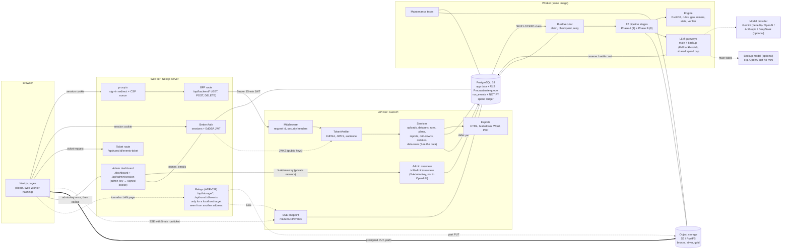

**Reading the picture**

- The **browser talks to three things**: the Next.js server (everything, through the BFF), object storage (file parts, via presigned URLs), and the API (exactly one path: the event stream).
- **Opened from another address** (a tunnel or LAN address) while storage or the API is on `localhost`, the browser cannot reach `localhost` on the host machine, so the web app relays part uploads and the event stream from its own origin. A deployment with public addresses never uses the relays (ADR-039); the AWS deployment uploads straight to S3 and streams straight from `api.ic.rgproject.me`.
- The **API never sees file bytes** and never sees passwords or cookies. It sees only a short-lived signed token.
- The **worker is the same Python package and image as the API**, started with a different command. It is the only place where heavy work and model calls happen. **Without a running worker, runs stay queued**, and the run page says "Waiting for a worker".
- **PostgreSQL does four jobs**: business data, the job queue (Procrastinate), the event log with `LISTEN/NOTIFY` wake-ups, and the authentication tables. That is one fewer system to run (tenet 4). Since 21 Oct 2026 it also holds the model **spend ledger and caps**, reachable only through `SECURITY DEFINER` functions.
- The **admin dashboard** (`/dashboard`) is a separate lock from people's sessions: the operator types `ADMIN_DASHBOARD_KEY` once, the web server answers with a short-lived signed cookie, and only the web server calls the API's hidden admin endpoint with the key. It is switched off (a 404) when no key is configured.

### 2.1 How it is deployed (AWS, 22 Oct 2026)

The same three processes run in production on **one EC2 instance** (`deploy/aws`, run by the deployment owner). Nothing in the application changed for it: every difference is configuration.

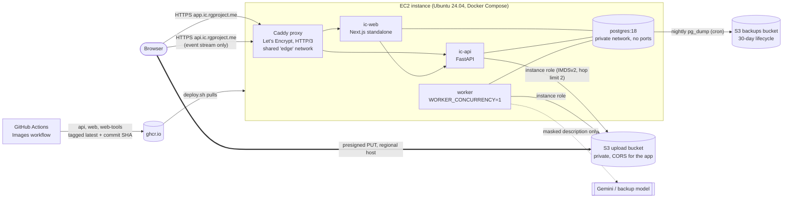

| Concern | How it is handled | Where |
|---|---|---|
| Build | GitHub Actions builds three images (`api` for API and worker, `web`, `web-tools` for the sign-in table migration) on every push to `main` that touches `backend/` or `frontend/`; the small server only pulls, because `next build` needs more memory than it has | `.github/workflows/images.yml` |
| Release and rollback | `./deploy.sh` pulls, creates the database roles (`ic_auth`, `ic_app_prod`, both `NOBYPASSRLS`), runs Alembic and the Better Auth migration, then starts `api`, `worker`, `web` and waits for health. `IC_IMAGE_TAG=<sha>` deploys or rolls back to one exact build | `deploy/aws/deploy.sh`, `compose.yml` |
| HTTPS and routing | A shared Caddy container owns ports 80/443, gets certificates automatically, and proxies `app.` to the web app and `api.` to the API with `flush_interval -1` so live progress is never buffered | `deploy/aws/proxy/` |
| Secrets | Three git-ignored files on the server only (`.env`, `backend.env`, `web.env`, mode 600), generated with random values by `init-env.sh`; no S3 keys at all (instance role) | `deploy/aws/init-env.sh` |
| Storage | Amazon S3, block-public-access on, default encryption; CORS limited to the app origin and exposing `ETag`; the IAM policy allows only the upload bucket and write-only access to `backups/ic/*` | `iam-policy.json`, `s3-cors.json` |
| Database | PostgreSQL 18 in a container on the private network (no published port). Not RDS, because migration `0001` creates a `BYPASSRLS` maintenance role that needs a real superuser | `compose.yml` |
| Backups | `backup.sh` streams `pg_dump -Fc` to the backups bucket nightly from cron; EBS daily snapshots (keep 7) cover the whole volume, Caddy's certificates included | `deploy/aws/backup.sh` |
| Capacity | A free-tier `t3.micro` (2 vCPU, 1 GB) with 4 GB swap; the worker runs one analysis at a time. Resizing to `t3.small`/`t3.medium` is a stop, change type, start | `deploy/aws/README.md` |
| Language model | Optional, as everywhere: `backend.env` takes the `LLM_*` lines and keys. Left unset on the live host (22 Oct 2026), so every run uses the deterministic fallbacks (§5) | `backend.env.example` |
| Cost | Free-tier instance and 30 GB gp3; about 3.6 USD a month for the public IPv4 address outside the free tier, plus cents for S3; model spend capped by `LLM_SPEND_CAP_AUD` (5) and `LLM_USER_SPEND_CAP_AUD` (1) with `LLM_USAGE_LABEL=prod` | `backend.env.example` |

**Fallback view.** A crashed container restarts (`restart: unless-stopped`); a lost instance is rebuilt from the repository, the three env files and the latest dump (`README.md`, "Restoring a backup"). There is one instance, so there is no high availability: a reboot or a resize is downtime. **Security view.** Only Caddy is reachable from the internet (plus SSH from one address); the API trusts `X-Forwarded-*` only because Caddy is the sole way in, which also gives the sign-in throttle a trustworthy client address (F-07's precondition). Instance metadata is IMDSv2-only.

---

## 3. Components

Each component lists: **what it does**, **basic logic**, **fallback**, **value**.

### 3.1 Frontend (Next.js 16, App Router) — `frontend/src`

| Component | Source | What it does and basic logic | Fallback | Value |
|---|---|---|---|---|
| **Request gate** | `proxy.ts`, `lib/csp.ts` | On every page request: no session cookie → redirect to `/sign-in`. Public without a session: `/sign-in`, `/sign-in/*` (the email-link page), `/dashboard` (it has its own admin lock) and `/api/*`; icons and the web manifest skip the proxy so they load before sign-in. It generates a per-request **nonce** and sets the Content-Security-Policy. The cookie check is only a convenience; the real check happens in the layout and the API. | A forged cookie reaches a page, but every data call then fails at the API. | Cheap first line; strict CSP. |
| **Authentication** | `lib/auth-options.ts`, `lib/auth.ts`, `lib/identity.ts`, `components/auth/sign-in-form.tsx`, `components/auth/email-link-form.tsx`, `app/sign-in/email/page.tsx` | **Better Auth**: email + password (register or sign in) and optional Google. Registration asks for the password twice (**Confirm password**), and every password field has a **Show password** toggle. The emailed sign-in link is **off by default** (`EMAIL_LINK_SIGN_IN=off`: the button is disabled). Switched on, "Email me a sign-in link" opens its own page (`/sign-in/email`), and a link is sent only to addresses in `EMAIL_LINK_ALLOWED_EMAILS` (blank: anyone). Anyone else gets `403 EMAIL_NOT_ALLOWED` with a message that never names who is allowed, because Resend's test sender reaches only the account owner. Testers can no longer paste their own Resend key: that ADR-029 path was removed on 21 Oct 2026. First sign-in creates a personal workspace (organisation, role owner). The `jwt` plugin mints a **15-minute EdDSA token** with `sub`, `org_id`, `org_name` and `role`. Sessions last 7 days, the cookie cache is **off** (sign-out ends access at once), the `/token` route is **disabled**, and sign-in is rate-limited. Better Auth trusts every address the app is served at (`BETTER_AUTH_URL` plus `AUTH_TRUSTED_ORIGINS`). The form keeps its submit button **disabled until the page's scripts have loaded**, so it never falls back to a plain GET that would put the password in the address bar. | Auth database down → "Sign-in is unavailable" with *Try again*, never "signed out". The BFF returns `503 auth-unavailable`. Each failure has its own message: server unreachable, address not allowed (`INVALID_ORIGIN`), server error, too many attempts; scripts not loaded after 8 s → a CSS-only notice. | People get in without a mail provider; tenancy claims come from a trusted source. |
| **BFF** | `app/api/backend/[...path]/route.ts`, `lib/backend-policy.ts`, `lib/backend.ts` | The only way the browser reaches the API (**GET, POST, DELETE**). Checks: the path is on an **allow-list** (`v1/me`, `v1/uploads`, `v1/datasets`, `v1/runs`; the event stream path is **denied**); mutations must carry one of this app's own origins (`appOrigins()`: `BETTER_AUTH_URL` plus `AUTH_TRUSTED_ORIGINS`, ADR-038). It refuses a request body over **2 MiB** (`MAX_BODY_BYTES`, checked on the declared length and again on what was read) before calling the API, mints the token from the session, forwards only allow-listed headers, times out after 30 s, and strips everything else from the response. `v1/admin` is not on the allow-list. Server components use `serverApi` (token minted server-side). | API unreachable → `503 api-unavailable` problem; body too large → `413 body-too-large`. | The browser never holds a credential that can act on the API. |
| **Event ticket** | `app/api/runs/[runId]/events-ticket/route.ts`, `lib/events-ticket.ts` | Mints a **5-minute JWT scoped to one run** with its own audience (`insightfulcell-events`). Returns the API's stream URL, or the same-origin relay path when the page is on another address and the API on `localhost`. | Same as the BFF (401/503 problems). | Live progress without opening the whole API to the browser. |
| **Same-origin relays** | `lib/relay.ts`, `app/api/storage/[...path]/route.ts`, `app/api/runs/[runId]/events/route.ts` | Used only when the target is loopback and the page is not (`needsRelay`). **Storage relay**: `PUT` only, answers only while `S3_PUBLIC_ORIGIN` is loopback and the URL is SigV4-signed, from a trusted origin; a part ≤ 64 MiB is buffered and forwarded unchanged to the same host (the signature covers it); only status and `ETag` come back. **Events relay**: forwards the ticket, `Last-Event-ID` and request id to the API stream and passes it through unbuffered. `proxy.ts` skips `/api/storage/`. | Otherwise `404`; another site's origin → `403`; missing or oversized length → `413`; storage or API unreachable → `503`. | Friends can test through one tunnel: sign in, upload and watch a run. |
| **Uploader** | `lib/upload/*`, `components/upload/upload-dropzone.tsx` | Validates the name and size → `POST /v1/uploads` → PUTs **8 MiB parts straight to storage** (3 at a time) while a **Web Worker computes SHA-256** → `:complete` with the part list and digest. | Retry with backoff (4 attempts, ≤ 8 s); an expired URL is re-presigned; failure aborts the upload and shows a specific message. | Large files, resumable, the UI never freezes. |
| **Start an analysis** | `components/runs/start-run-button.tsx` | **Automatic** (default: the run goes straight to the report) or **Manual** (the run stops for review). | A replay uses the same `Idempotency-Key`; changing the mode resets it. | One click for the common case; control when wanted. |
| **Run page and live progress** | `components/runs/run-progress.tsx`, `stage-list.tsx`, `lib/runs/sse.ts`, `reducer.ts` | Shows the 12 stages and their summaries, failure reasons, cancel, retry and delete. It follows events over a **fetch-based SSE reader** and reconnects with `Last-Event-ID`. Shows "Waiting for a worker" when no worker is alive. | 4 failures, a 401, a non-SSE response or 40 s of silence → **polls `GET /v1/runs/{id}` every 3 s**. | The user sees work happen, even behind hostile proxies. |
| **Plan and review** | `app/o/[org]/runs/[runId]/plan`, `review`; `components/plans/*` | Shows what each column was understood to be, each proposed cleaning change with before/after previews and rows affected, and **Apply all / Keep all as is**. The person can rename columns, set units, choose the outcome, switch features off, remove questions, or write requests in words. | Approving with undecided changes keeps them as they are (not applied); a stale view is refused by `If-Match` (412). | Human in the loop exactly where data could be lost. |
| **Report and dashboard** | `app/o/[org]/runs/[runId]/report`, `dashboard`; `components/report/*` | Dashboard: headline tiles, top findings, maps, gallery, suggested questions answered with verified sentences. Report: summary and answers with **citation chips** that open the **fact inspector** (statement, evidence tier, test, sensitivity check, content hash), accessible SVG charts and maps, an "Evidence" block, and a "Narration simplified" notice with **Write the answers again**. | Report not ready → "not ready yet"; skipped questions are listed with reasons; withheld charts are named. | Any number can be traced without leaving the page. |
| **See the data** | `components/report/data-sidebar.tsx`, `report-nav.tsx`, `globals.css` | "See the data" on the report and dashboard opens a **non-modal side panel** with the table as it was read (before cleaning), 100 rows a page, sticky headers, Previous / Next. Personal-data columns show `•••` ("hidden"). Width 25 % of the window by default, 20–90 %, set by dragging the ⋮⋮ grip or with the arrow keys (a `separator`), remembered per browser; closed by its arrow or Escape, reopened from an edge tab. On wide screens the page makes room; on narrow ones the panel covers it. | 409 before ingest has finished → "The data is not available yet"; any error → problem alert with *Try again*. | Check findings against the rows without downloading anything. |
| **Downloads, explore, delete** | `download-menu.tsx`, `print-button.tsx`, `explore.tsx`, `explorations.tsx`, `components/ui/delete-action.tsx` | Download PDF, Word, Markdown or HTML, or print. **Explore** one group from a table row or a map region (a drill-down sub-run). **Delete** a run or a dataset with an in-place confirmation. | Errors become problem alerts with a request id. | Reports leave the app intact; users can follow up and clean up. |
| **Admin dashboard** | `app/dashboard/page.tsx`, `app/api/admin/session/route.ts`, `lib/admin-session.ts`, `lib/admin-data.ts`, `components/admin/*` | `/dashboard` exists only when `ADMIN_DASHBOARD_KEY` is set (≥ 32 characters). Locked, it renders no figures, only a key dialog over a blurred placeholder. `POST /api/admin/session` `{key}` (trusted origin, body ≤ 2 KB) compares SHA-256 digests in constant time and sets an `HttpOnly`, `SameSite=Strict` cookie (`__Host-ic_admin` over https), HMAC-signed with a secret derived from the key, valid for `ADMIN_SESSION_MINUTES` (default 30, 5–720). Changing the key locks every open dashboard. `DELETE` locks it again. Unlocked, the page reads `GET /v1/admin/overview?days=7/30/90` from the API with `X-Admin-Key` and the accounts (name, email, sign-in methods, workspace, last activity, live sessions) from Better Auth's tables. Sections: totals (people, files, analyses, spend against the cap), spend per provider against its own cap, spend per day, by model (calls, tokens, p50/p95 latency), outcomes, purpose, label, people, analyses per day, storage and queue, configuration (never keys), and OpenAI's own cost report when `OPENAI_ADMIN_KEY` is set. | Key not configured → 404; wrong key → 401, and after 5 wrong keys from one address or 30 overall in 15 min → `429` with `Retry-After` (counted in memory); API or accounts database unreachable → "The dashboard's figures couldn't be loaded" with *Try again*. | The operator sees who uses the demo and what it costs without a database console. |
| **Recipe** | `app/o/[org]/runs/[runId]/recipe`, `components/plans/recipe-view.tsx`, `privacy-note.tsx` | Downloads a Python script that reproduces the cleaning, features and charts, and shows what a model would be sent. | — | Reproducibility and exit. |
| **Hardening** | `lib/csp.ts`, `lib/env.ts` | Nonce CSP, `connect-src` limited to self, storage origin and API origin; environment validated with zod (production requires https and browser-facing addresses that are not `localhost`, forbids the console mail transport, requires distinct token audiences; every `AUTH_TRUSTED_ORIGINS` entry must be a bare origin, https when `BETTER_AUTH_URL` is; every `EMAIL_LINK_ALLOWED_EMAILS` entry must be an email address, and in production the list is required when links go out from Resend's test sender; `ADMIN_DASHBOARD_KEY` ≥ 32 characters; blank optional values count as unset). `next dev` accepts only the trusted hosts (`allowedDevOrigins`). | Start-up fails fast on bad config. | Misconfiguration cannot silently weaken security. |

### 3.2 Backend (Python 3.13, FastAPI, DuckDB) — `backend/src/insightfulcell`

#### 3.2.1 API tier

| Component | Source | What it does and basic logic | Fallback | Value |
|---|---|---|---|---|
| **Request context** | `api/middleware.py` | Assigns or validates `X-Request-Id`; logs method, path, status and duration (**never** the query string or headers); adds security headers; catches unexpected exceptions. | Unhandled error → generic 500 problem with the request id. | Debuggable, safe-by-default responses. |
| **Problems** | `api/problems.py`, `domain/errors.py` | Every failure is `application/problem+json` with `code`, `hint` and `request_id`. | Framework errors are converted too. | Clients branch on stable codes. |
| **Token verification** | `auth/tokens.py`, `api/deps.py` | Verifies the Bearer JWT **offline** against the JWKS (cached 5 min; refetched once on an unknown `kid`). The algorithm is pinned to EdDSA, and `exp`, `iat`, `sub`, `iss` and `aud` are required. | JWKS unreachable → `503 identity-provider-unavailable`. | No algorithm confusion; no auth call per request. |
| **Authorization** | `domain/security.py` | One policy table `Action → roles`. Viewers read. Analysts, admins and owners also upload, start, cancel, decide, explore and delete. | Missing role → 403 with a hint. | Reviewable in one place. |
| **Tenancy** | `db/tenant.py`, `db/session.py`, `db/identity.py` | `transaction(principal)` sets `app.org_id` transaction-locally and mirrors user and organisation rows just-in-time. | Connection failure → `503 database-unavailable`. | Cross-tenant reads are impossible even if a query forgets a filter. |
| **Idempotency** | `services/idempotency.py` | `Idempotency-Key` is claimed in the same transaction as the work (uploads, runs, drill-downs). | Keys are purged after 24 h. | Safe client retries. |
| **Uploads** | `services/uploads.py`, `storage/s3.py`, `ingestion/formats.py` | See §4.2. | Replay-safe `:complete`; abandoned uploads aborted. | Large files without API bandwidth cost. |
| **Runs, plans, reports** | `services/runs.py`, `plans.py`, `reports.py`, `run_store.py` | Create (with `review_mode`), read, list, cancel, retry, **revise** or **decide** the plan, **re-narrate** a simplified report, read the report and dashboard, export them, and download the recipe. Every status change is compare-and-set; `If-Match` carries `row_version`. | A failed job defer leaves the run queued; the **reconciler** re-defers it. | Exactly-once effects, explicit human decisions. |
| **Drill-downs** | `services/drilldowns.py`, `engine/subset.py` | `POST /v1/runs/{id}/drilldowns`: a sub-run of the same version starting at Phase B, reusing the parent's Phase A checkpoints, plan and approved cleaning. Limits: ≤ 20 groups, ≥ 30 rows, ≤ 25 per run, not nested. | `409 report-outdated` for a run of another pipeline version. | Follow a lead without re-planning. |
| **Deletion** | `services/deletion.py`, migration `0010` | `DELETE /v1/runs/{id}` and `DELETE /v1/datasets/{id}` remove the rows at once through `SECURITY DEFINER` functions and schedule the files in `storage_purges`. | A running run is refused (`409 still-running`). | Data can be removed on request. |
| **Data rows ("See the data")** | `services/data_rows.py`, `GET /v1/runs/{id}/rows` | Requires `data:read` (every role). Reads the `ingest` stage's typed Parquet (`artifacts["data"]`), the file as the analysis read it. The artifact is copied once to a private local cache (`$TMPDIR/insightfulcell-data-cache`, mode 0700, ≤ 16 files, dropped after an hour unread) and paged with DuckDB (1 thread, 256 MB): `offset`, `limit` ≤ 200, text cut at 500 characters, large integers, decimals and dates as text. Personal-data columns (from `semantics.json`) are listed with their kind; their cells are `null` and **never read**. | `409 data-not-available` until ingest has succeeded; 404 outside the caller's organisation. The run is checked in the database on every request, so a deleted run's cached copy is never served. | People can check findings against the rows. |
| **Admin overview** | `api/routers/admin.py`, `services/admin.py`, `services/provider_usage.py`, migrations `0011`, `0012` (`app.admin_overview`, `app.llm_spend_by_provider`) | `GET /v1/admin/overview?days=1..365` (hidden from the OpenAPI schema; not forwarded by the BFF; not exposed by the production reverse proxy). The `X-Admin-Key` header is compared with `ADMIN_DASHBOARD_KEY` by constant-time digest comparison. Returns counts and sums across every organisation (people by id, never file names, rows, prompts or keys): spend totals, held and estimated amounts, by day, model, outcome, purpose, label and provider (each beside its own cap), runs by status and day, durations, failures, storage, queue, configuration, plus OpenAI's own Usage and Costs report (cached 10 min) when `OPENAI_ADMIN_KEY` (read-only admin key) is set. | Missing or wrong key, or endpoint off → the same `404 not-found`; OpenAI report failing → `status: unavailable`, never an error. | One endpoint feeds the dashboard; nothing about tenants is exposed to the public API. |
| **Event stream** | `api/routers/runs.py`, `db/notifications.py`, `api/cors.py` | SSE with replay from `Last-Event-ID`, ticket-only auth, and one `LISTEN` per API instance. CORS is enabled for this one path only, for `EVENTS_ALLOWED_ORIGINS`. | A missed notification → a 15 s keep-alive re-checks; the listener reconnects. | Live feel with one database connection per instance. |

#### 3.2.2 Worker and pipeline

| Component | Source | What it does and basic logic | Fallback | Value |
|---|---|---|---|---|
| **Queue** | `queue/procrastinate_queue.py`, `worker/tasks.py` | PostgreSQL job queue (`FOR UPDATE SKIP LOCKED`); `queueing_lock = run_id`; queues `standard`, `large`, `maintenance`. | `AlreadyEnqueued` ignored; infra errors retried. | No extra broker. |
| **Start-up model check** | `worker/runtime.py:check_model`, `build_gateway` | Before taking work, looks up the configured models with each key, the main model's and the backup's (free: `models.get`, no tokens). `build_gateway` builds one gateway per provider with its own breaker, quota pause and pacing, wraps them in `FallbackModel`, gives both one `DbSpendGuard`, and logs the caps (never a key). | One model: a rejected key or unknown model → the worker refuses to start with a message. With a backup: it refuses only when **both** fail; otherwise the broken one is logged as an error and skipped. Unreachable or quota used up → warning; runs fall back. | A misconfigured model is caught once, not on every run. |
| **Run executor** | `services/run_executor.py` | Per phase job: **claim** (re-read the run under its organisation, per-organisation concurrency limit) → for each stage compute a **checkpoint key**, reuse a finished stage with the same key, else run it → finish the phase (review gate, defer Phase B, or succeed). Cancel takes effect at the next stage boundary. | See §5. | Resumable, cancellable, bounded work. |
| **Stages** | `pipeline/*.py` | Phase A: `ingest → profile → understand → clean_plan`. Phase B: `clean_apply → geo → features → mine → sensitivity → rank → visualize → report`. Each returns a small JSON summary (never cell values) and artifact keys. | See §5. | Each stage can be tested, cached and explained alone. |
| **Maintenance** | `services/maintenance.py` | Every minute: reconciler, reaper. Every 15 min: review reminders (24 h) and expiry (7 days). Hourly/daily: partitions, abandoned uploads, **deleted files' purge**, idempotency keys, old jobs. | Each task is idempotent and org-scoped. | The system heals itself. |

#### 3.2.3 Engine (pure analysis logic, no framework) — `engine/`

| Component | Source | What it does and basic logic | Fallback | Value |
|---|---|---|---|---|
| **Ingestion engine** | `ingestion/engine.py`, `limits.py` | Any supported file → **typed Parquet** with DuckDB. Limits: 250 MB, 1 M rows, 500 columns. Encoding detection (UTF-8, UTF-16, cp1252); **every CSV/TSV row checked against the header** (a ragged row fails with its line number). | Typing failure → re-read **all as text** with a warning. | Hostile or messy files cannot exhaust the worker or silently collapse. |
| **Semantics** | `engine/semantics.py` | A **meaning** per column and **personal-data** flags (email, phone, name, national id, address, birth date, IP, card) from the name *and* counts over every value. | Leans to flagging. | The privacy decision is made before any model sees anything. |
| **Profiling** | `engine/profiling.py` | Per-column statistics and quality flags over every row. Personal-data columns get **counts only**. | — | A factual base for planning and review. |
| **Schema card** | `engine/schema_card.py` | The only description of the table a model may read (see §4.7). Token-budgeted (9,000) in tiers. | Tiers instead of truncation. | Useful planning without exposure. |
| **Planner** | `engine/planning/*` | The **rule planner always runs first**; a model refines its draft; every item is validated; the result is merged with the person's choices, frozen and hashed. Plans are cached per schema fingerprint. | Any model failure → the rule plan stands. | Runs never depend on an AI. |
| **Cleaning** | `engine/cleaning/*` | 14 typed operations, each **lossless** or **lossy**, each one SQL expression, measured on every row. | Lossy changes are never applied without a person (or automatic mode). | Reviewable, reversible cleaning, exported as code. |
| **Places** | `engine/geo/*`, `engine/analysis/places.py`, `regions.py` | Country, state and Australian postcode names and coordinates → standard regions (Natural Earth 5.1.2), ≥ 80 % match rule; maps as SVG paths. | Unmatched columns stay as text, with a quality fact. | Places become comparable groups and maps. |
| **Signal gate** | `engine/analysis/signal.py` | A planned feature is kept only if its mutual information with the outcome beats all of 19 shuffles, and it is not redundant (rank correlation ≥ 0.95). | No outcome → no features. | Engineered columns cannot add noise. |
| **Miners and statistics** | `engine/analysis/miners.py`, `stats.py`, `facts.py` | Nine question types answered in DuckDB with one primary test each (rank-based where possible). **Benjamini-Hochberg at 5 %** across the run; facts tiered strong / supported / inconclusive / descriptive. Drivers only after a model shows held-out skill; a leakage note at 0.95. Groups under 10 rows are pooled. | A miner that cannot run skips the question with a reason. | Numbers come from SQL and tests, not from a model. |
| **Sensitivity and rank** | `engine/analysis/sensitivity.py`, `rank.py` | The top 10 reliable findings are re-tested on minimally cleaned data (holds / weakens / flips); findings are ranked by evidence, size, relevance and novelty. | — | Findings that depend on cleaning are marked. |
| **Chart and map checks** | `engine/analysis/charts.py`, `claims.py` | Every chart point and map region carries a claim; each claim is recomputed with its own query. | A mismatch withholds the chart. | No chart shows a value the data does not hold. |
| **Narration and verifier** | `engine/analysis/narrate.py`, `prompt.py`, `verifier.py` | One model call per question (concurrently), numbers as **slots** (`{F3.1}`) filled by the engine, **six checks** per sentence, one repair, template fallback, summary last. See §4.7. | Model off or failing → the engine writes from the facts' own statements. | Fluency is optional; correctness is not. |
| **Report, dashboard, exports** | `engine/analysis/report.py`, `dashboard.py`, `exports/*` | Report v4 and dashboard v1 saved as one revision; HTML (Jinja, strict CSP, no script), Markdown, Word (python-docx), PDF (fpdf2), charts as images (resvg). | — | The same content in every format. |
| **LLM gateway** | `llm/gateway.py`, `breaker.py`, `providers/*` | One entry for all model calls: purpose → model tier, circuit breaker, **payload guard**, token budgets, a **spend reservation per attempt**, retries, rate-limit waits, quota pause, JSON parse and Pydantic validation, `llm_calls` accounting. | Any failure raises `ModelUnavailable`; the backup model is asked, or callers fall back. | Cost, privacy and reliability rules written once. |
| **Backup model** | `llm/fallback.py`, `llm/providers/__init__.py` | `FallbackModel`: main gateway first; on `ModelUnavailable` the **same request** goes once to `LLM_FALLBACK_PROVIDER` / `LLM_FALLBACK_MODEL` (one model for both tiers). Never for `payload_blocked`, `spend_cap`, `spend_cap_user`, `spend_unavailable`, `budget_run` or `budget_org`. A main provider at its own cap (`spend_cap_provider`) does hand over. The backup's ledger rows carry `fallback = true`. Start-up refuses a backup equal to the main provider, without its key or without a model. | Both fail → rules plan / template text, as with one model. | A Gemini quota or outage no longer simplifies a report. |
| **Spend cap and ledger** | `services/llm_spend.py` (`DbSpendGuard`), `llm/pricing.py`, migrations `0011`, `0012` | Before each attempt the gateway reserves its **worst case**: estimated input × 1.5 + 200 tokens, plus the full `LLM_MAX_OUTPUT_TOKENS`, at the model's list price, rounded up. `app.llm_spend_reserve` (one advisory lock) refuses when the overall cap (`LLM_SPEND_CAP_AUD`), the provider's own cap (`LLM_SPEND_CAP_<PROVIDER>_AUD`) or the person's (`LLM_USER_SPEND_CAP_AUD`, 0 = off) has no room for spent + held + this. Caps are in AUD and converted at `LLM_USD_TO_AUD` (default 1.60); `none`/`na`/blank = no limit, 0 = no paid calls. When the attempt ends, `app.llm_spend_record` writes the real cost, or an estimate: the full reservation after a timeout, the input after a provider error or refusal, zero for a call refused before any work. The hold is then released; an unreleased hold expires after `LLM_SPEND_HOLD_SECONDS` (600). A log line per attempt gives the running totals, with a warning at 50 %, 80 % and 95 % of each cap. | No price for the model → `price_unknown` (never called); cap has no room → `spend_cap*`; ledger unreachable → `spend_unavailable` (fail closed). Each falls back to rules or templates. | Model cost can never pass the configured amount, even with many testers at once. |

#### 3.2.4 Language model: which model, what it is asked, what it returns

| Item | Value |
|---|---|
| Provider | `LLM_PROVIDER` (default `gemini`; `openai`, `anthropic`, `deepseek`, `none`). Setting it without its key fails start-up; leaving it unset with no key turns the model off (rules only). |
| Models (Gemini defaults, `llm/providers/__init__.py`) | **strong** `gemini-3.5-flash-lite` (planning and narration), **fast** `gemini-3.1-flash-lite` (judge; routing reserved for Q&A). Override with `LLM_MODEL_STRONG` / `LLM_MODEL_FAST`. `gemini-3.8-flash` was the previous strong default. |
| Backup model | `LLM_FALLBACK_PROVIDER` (default `none`) with `LLM_FALLBACK_MODEL`; the README and `.env.example` suggest `openai` + `gpt-4o-mini` (needs `OPENAI_API_KEY`). |
| Price (paid tier, per 1 M tokens, input / output) | 3.5 Flash-Lite $0.30 / $2.50 · 3.1 Flash-Lite $0.25 / $1.50 · 3.8 Flash $0.75 / $3.75 (doubles 1 Jan 2027) · `gpt-4o-mini` $0.15 / $0.60 (checked 21 Oct 2026; shuts down 14 Jan 2027). Free-tier calls are not billed. A model with no built-in or `LLM_PRICES_JSON` price is **never called while a spend cap is on**. |
| Spend caps | `LLM_SPEND_CAP_AUD`: code default 4.00 (overall, for the life of the database); `backend/.env.example` sets `none` overall, `LLM_SPEND_CAP_OPENAI_AUD=4.50`, Gemini `none`. `LLM_USER_SPEND_CAP_AUD` 0 (off). `LLM_USAGE_LABEL` (default `local`) tags every spend row. |
| Calls per run | 1 planning call (none on a plan-cache hit), 1 narration call per answered question, 1 summary call, at most 1 repair call per part, plus retries. The judge (off by default) adds 1 call per accepted sentence. |
| Request format | `system` text + one `user` message + a JSON Schema; Gemini: `response_mime_type="application/json"`, `response_json_schema`, `max_output_tokens=16000`, timeout 90 s. |
| Planning asks for | A complete plan (`ProposedPlan`): dataset summary, domain, grain, dictionary (meaning, role, display name, unit per column), target, cleaning, features, analyses, charts, relevance, request outcomes. Choices come only from catalogues, and column names are an `enum` of the real columns. |
| Narration asks for | `{"sentences": [{"text": "...{F3.1}...", "citations": ["F3"]}]}`: 2–4 sentences per question (3–5 for the summary), with numbers only as slots. |
| What comes back | JSON text. The gateway strips Markdown code fences, runs `json.loads`, then validates with Pydantic. Plans parse **leniently** (missing nullable fields count as null; items that do not fit are dropped and counted). |
| Bad format | Truncated, empty, not JSON or schema mismatch → logged as `invalid` (with field paths, never content) and counted as one failed attempt; after 3 failures → `ModelUnavailable("invalid_output")` → rules plan or template sentences. |

---

## 4. Data flows

### 4.1 End to end: from file to report

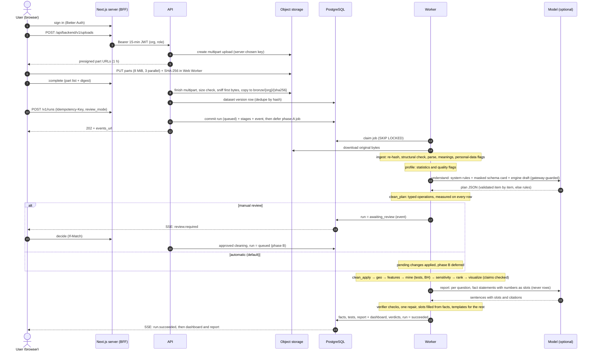

### 4.2 Upload and verification

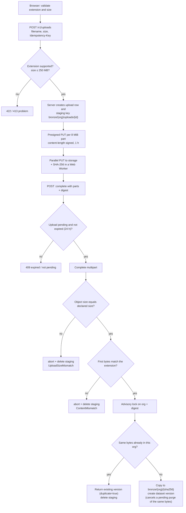

The **digest is recorded as a claim** and verified later by the worker, which re-hashes the stored bytes (ADR-026).

**From another address.** `putPart` sends a part to the presigned URL as is, unless the URL points at `localhost` and the page does not: then it sends the same path and query to the web app's `/api/storage/…` relay, which forwards the bytes unchanged to storage (`lib/relay.ts:partUploadUrl`, ADR-039).

### 4.3 Run lifecycle (state machine)

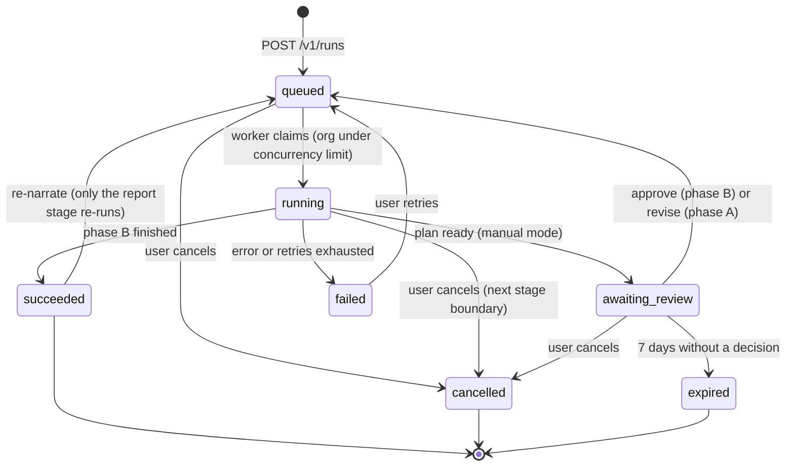

Every transition is `UPDATE … WHERE status IN (…)` (compare-and-set) that also bumps `row_version`. When Phase A needs no review (automatic mode or the `auto_safe` policy), the run **stays `running`**: its phase becomes B and the Phase B job is deferred. A run that is not running can be deleted.

### 4.4 The pipeline and what each stage reads and writes

```mermaid
flowchart LR
    subgraph PhaseA["Phase A"]
        I["ingest<br/>data.parquet, semantics.json"] --> P["profile<br/>profile.json, run_columns"]
        P --> U["understand<br/>plan.json, schema_card.json,<br/>analysis_plans  (LLM call 1)"]
        U --> C["clean_plan<br/>cleaning_plans / ops"]
    end
    C --> G{{"Review gate<br/>(manual mode only)"}}
    G --> CA
    subgraph PhaseB["Phase B"]
        CA["clean_apply<br/>silver cleaned + minimal"] --> GEO["geo<br/>regions"]
        GEO --> FE["features<br/>signal gate"]
        FE --> MI["mine<br/>run_facts, test_log"]
        MI --> SE["sensitivity<br/>rechecks"]
        SE --> RA["rank<br/>highlights"]
        RA --> VI["visualize<br/>verified charts + maps"]
        VI --> R["report<br/>run_reports + dashboard,<br/>verification_results (LLM calls 2..n)"]
    end
    G -. "ask for changes" .-> U
```

Artifacts live at `gold/{org}/{run}/{stage}/{checkpoint}-{name}`; cleaned data at `silver/{org}/{version}/{hash}.parquet`. All keys are built by the server.

### 4.5 Live progress

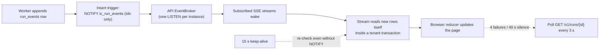

The browser asks the ticket route for a ticket and a URL. The URL is the API's own stream, or `/api/runs/{id}/events` on the web app when the page is on another address and the API on `localhost` (the relay passes the stream through unbuffered).

### 4.6 Privacy path for the language model

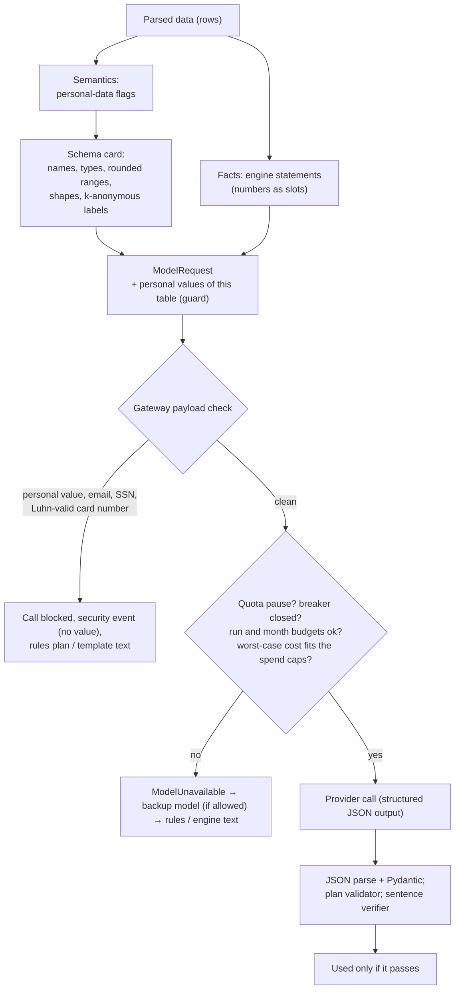

Rows never appear in this path. Only the card and the engine's draft plan (for planning) and fact statements (for narration) are ever sent. A request the payload check blocked is **never** passed to the backup provider either.

### 4.7 What the model is sent and what it must return

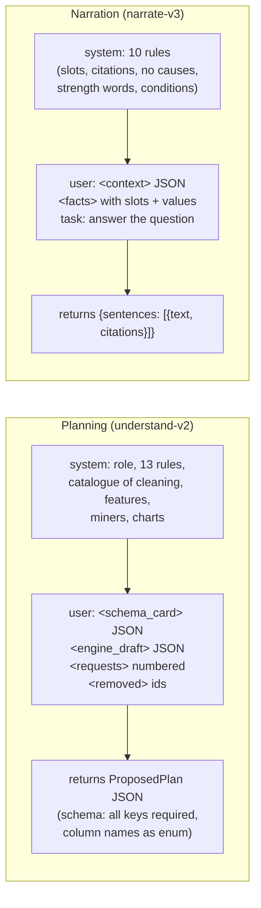

A real planning request for a 25-row, 50-column file: system prompt about 5,800 characters, user message about 33,000 characters (schema card ≈ 5,100 tokens plus the engine draft), JSON schema about 12,800 characters, ≈ 11,400 estimated input tokens. Full prompt text and examples are in [explained_system_flow.md](explained_system_flow.md) §16–§18 and §27.

### 4.8 "See the data"

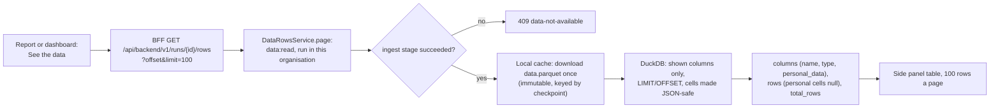

The rows go only to the signed-in person's browser; nothing in this path reaches a model.

### 4.9 Model spend cap and backup model

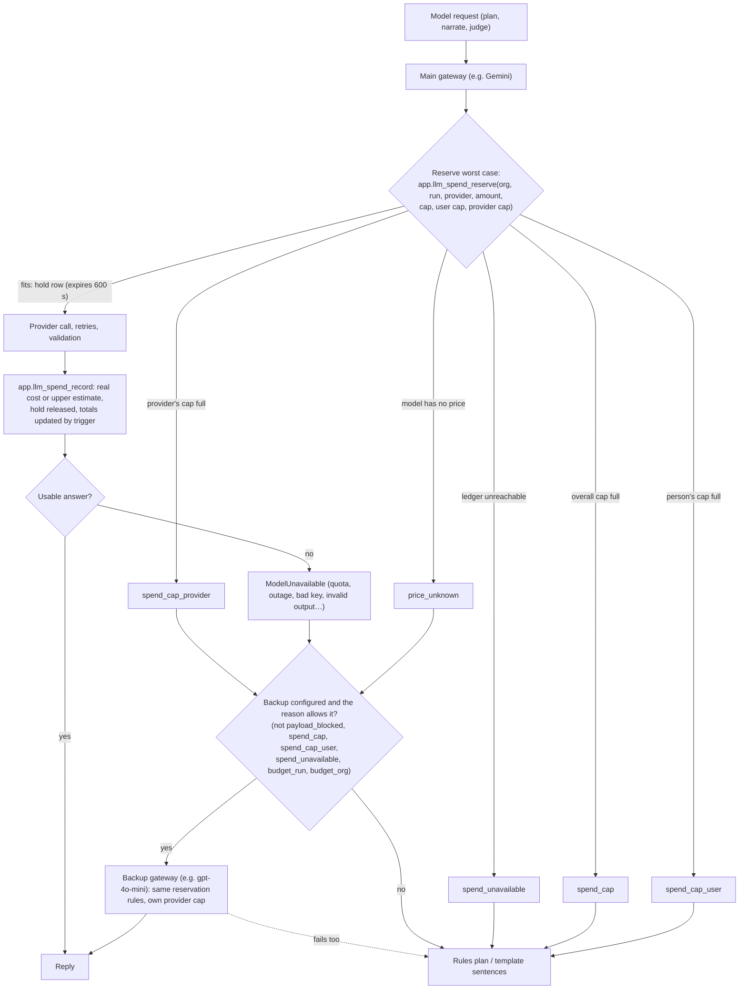

The ledger (`app.llm_spend`) is append-only and **outlives** deleted runs, datasets and people, so a total can never shrink. The application role has no grant on the spend tables; it calls only the definer functions. Spend is in USD at list price (rounded up) and shown in AUD.

---

## 5. Fallbacks, in one table

| Situation | What the system does | User sees |
|---|---|---|
| No model key / `LLM_PROVIDER=none` | Rule planner plans; the engine writes all report text | Plan source "rules"; report "written by the engine" |
| `LLM_PROVIDER` set without its key | API and worker refuse to start | A start-up error naming the missing key |
| Unknown model id or rejected key (worker start) | `check_model` stops the worker with what to fix | Worker does not start |
| **HTTP 404** from the provider | Permanent `provider_error` (or `model_not_found` at start-up); no retry | Rules plan / template text |
| **HTTP 429**, per-minute limit | Waits as long as the provider asks (`retryDelay`), up to 60 s, up to 4 times, without counting a failure | Slower run |
| **HTTP 429**, per-day quota (or a wait > 60 s) | `quota_exhausted`: every model call stops for that time (≤ 1 h) | Rules plan, "Narration simplified" |
| **HTTP 503 / 500 / 504**, timeout, dropped connection | Transient: breaker failure, back-off 1 s, 2 s (+ jitter), up to 3 attempts | Same as above, with the reason recorded |
| 5 failures in 60 s | Circuit breaker opens for 60 s, then one trial call | `breaker_open` fallback |
| Answer truncated, empty, not JSON, or wrong shape | Counts as a failed attempt; after 3, fallback | Same |
| Model plan has bad items | Each item dropped with a reason; the rest kept; rules fill gaps | "Rejected suggestions" on the plan page |
| Model sentence fails a check | One repair call with the failure; if it fails again, the fact's own statement is used | Plainer sentence |
| More than 30 % of a part's sentences fail | The whole part is written from templates and the prompt is flagged | Part written by the engine |
| Model unavailable for a part | That part from templates; report marked "Narration simplified" | **Write the answers again** button |
| Prompt would carry personal data | Call blocked before leaving; security log | Rules plan / template text |
| Run or organisation budget spent | `budget_run` / `budget_org` | Fallback text |
| Main model fails (quota, rate limit, outage, bad key, unusable answers, own provider cap) and a backup is set | The same request goes once to the backup model (`fallback = true` in the ledger) | Nothing, if the backup answers |
| Overall or per-person spend cap has no room for the worst case | `spend_cap` / `spend_cap_user`; no backup is tried | Rules plan; "this demo's model budget is spent" / "your share of this demo's model budget is spent" |
| Provider's own cap has no room | `spend_cap_provider`; the backup (another provider) may serve | Backup's answer, else "this demo's budget for the model provider is spent" |
| Model has no known price while a cap is on | `price_unknown`: never called (the backup is tried) | "the configured model has no known price…" |
| Spend ledger cannot be read | `spend_unavailable` (fail closed); a failed settle keeps the hold until it expires, so the cap still holds | "the model budget could not be checked" |
| Backup set without its key, equal to the main provider, or without a model | API and worker refuse to start | A start-up error naming the fix |
| Malformed CSV row (wrong field count, unclosed quote) | Refused with the line number, never a value | Message and hint |
| Type inference fails on a CSV | Re-read all columns as text, with a warning | Warning on the run page |
| Non-UTF-8 text | Transcoded (UTF-16 or cp1252) | Warning noted |
| File too big / too wide / too long / hostile Excel / empty | Specific `DomainError` fails the run without retry | Message and hint, no cell values |
| Stored bytes do not match the digest | `integrity-mismatch` | "Upload the file again" |
| Source object missing | `source-missing` | "Upload again, then start a new analysis" |
| Run started by another pipeline version (or Phase A keys changed) | `pipeline-changed` | "Start a new analysis of the same dataset" |
| Transient error in a stage | Back to pending, retry after `15 s × attempt`, up to 3 attempts | "Trying again (attempt n of 3)" |
| Out of memory, or worker died | Counted as a crash; after 2 crashes the run moves to the `large` queue; after 3 attempts it fails `worker-crashed` | "Moved to a larger worker" |
| No worker running | Run stays queued | "Waiting for a worker" with how to start one |
| Job lost between commit and defer | Reconciler re-defers it after 60 s | Nothing (self-heals) |
| Organisation at its concurrent-run limit (3) | Job re-deferred every 10 s | "Waiting for a free slot" |
| Nobody reviews (manual mode) for 24 h / 7 days | Reminder event / run expires | Banner / "Expired" |
| Review view is stale | 412 `run-changed` or `cleaning-plan-changed` | "Reload and check" |
| A chart value does not match the data | Chart withheld | "A chart was withheld" |
| A feature has no signal | Not added | Feature listed as not kept |
| Question cannot be computed | Miner skips with a reason | Listed under "could not be answered" |
| SSE blocked or silent | Polls every 3 s | Slightly slower updates |
| Auth database down | "Sign-in unavailable" page, `503` problems | Retry button |
| Page scripts not loaded (e.g. `next dev` refused an unknown host) | Submit stays disabled; the form is `method="post"`, so it can never send the password in the address | "The page is still loading…" notice after 8 s |
| Sign-in from an address that is not trusted | Better Auth answers `INVALID_ORIGIN` | "Sign-in isn't allowed from this web address" (run `make allow-origin`) |
| Auth server unreachable or failing during sign-in | The call is caught (`settle`) | "We couldn't reach the server" / "The server ran into a problem" |
| Page on another address, storage or API on `localhost` | Uploads and live progress go through the same-origin relays | Nothing (works as on the host) |
| "See the data" before ingest has finished | `409 data-not-available` | "The data is not available yet" with *Try again* |
| Request body over 2 MiB through the web proxy | `413 body-too-large` before the API is called | Problem alert |
| Sign-in link asked for an address not in `EMAIL_LINK_ALLOWED_EMAILS` | `403 EMAIL_NOT_ALLOWED`; nothing sent | "This email isn't set up with this project… Please register with your email and a password instead." |
| Admin key wrong / guessed repeatedly / not configured | `401` / `429` with `Retry-After` / `404` | "That admin key isn't right." / "Too many wrong keys…" / Not found |
| Admin dashboard: API or accounts database unreachable, or the two `ADMIN_DASHBOARD_KEY`s differ | Page shows a problem alert (the API answers 404 to a different key) | "The dashboard's figures couldn't be loaded" with *Try again* |
| API database down | `503 database-unavailable` | Retry |
| Storage fails during the purge sweep | The purge row is restored (transaction rolled back) | Nothing; retried next hour |

---

## 6. Security perspective

### 6.1 Trust boundaries and the identity chain

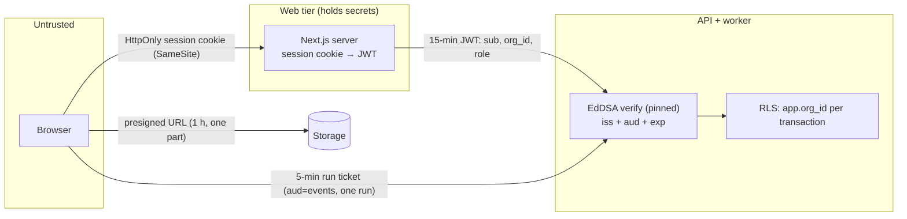

| Layer | Control | Where |
|---|---|---|
| Credentials | Passwords hashed by Better Auth (scrypt); the API never sees them. `Secure` cookie over https. | `auth-options.ts` |
| Token | EdDSA only; issuer, audience and expiry required; keys rotate every 30 days via JWKS | `auth/tokens.py` |
| Token exposure | `/api/auth/token` disabled (404) and no `set-auth-jwt` header; tokens are minted server-side only | `auth-options.ts` (`disabledPaths`, `disableSettingJwtHeader`) |
| Sign-out | Cookie cache off: a replayed cookie gets 401 right after sign-out | `auth-options.ts` |
| Token separation | API token audience ≠ event ticket audience; a ticket names one run and lasts ≤ 330 s | `config.py`, `tokens.py`, `env.ts` |
| Browser exposure | BFF allow-lists paths, methods and headers; mutations need one of the app's own origins (`appOrigins()`) | `backend-policy.ts`, `env.ts` |
| Relays | Storage relay: `PUT` only, loopback storage only, SigV4-signed URL required, trusted origin, ≤ 64 MiB, only status and `ETag` returned (storage error bodies name the bucket and key). Events relay: carries only the run ticket; the API still verifies it | `app/api/storage`, `app/api/runs/[runId]/events` |
| Authorization | Single role × action policy table | `domain/security.py` |
| Tenant isolation | Organisation id only from the token; explicit filters; **forced RLS** on every tenant table; composite foreign keys `(org_id, id)` | `services/*`, migrations `0002`–`0010` |
| Database roles | `ic_app` (NOBYPASSRLS); `ic_maintenance` (BYPASSRLS, used only through `SECURITY DEFINER` functions that return ids); deletes through definer functions only | `0001`, `0004`, `0010` |
| Worker tenancy | Worker re-reads the run under its organisation | `run_executor._claim` |
| Admin dashboard | Separate lock: key only on the server (≥ 32 chars, same value in both env files); constant-time digest comparison; signed `HttpOnly` `SameSite=Strict` cookie (`__Host-` over https) for ≤ 30 min by default; trusted origin; wrong keys throttled per address and overall; the API endpoint answers one 404 for "off" and "wrong key", is not in the OpenAPI schema, not on the BFF allow-list and not exposed by the production reverse proxy | `lib/admin-session.ts`, `app/api/admin/session`, `api/routers/admin.py` |
| Spend ledger | `llm_spend*` and `user_activity` tables: forced RLS with no policy and no grant to `ic_app`; reached only through `SECURITY DEFINER` functions (`llm_spend_reserve`, `llm_spend_record`, `llm_spend_by_provider`, `admin_overview`) | migrations `0011`, `0012` |

### 6.2 Data protection

| Concern | Handling |
|---|---|
| Raw rows to a model | Never. Only the masked schema card and engine draft (planning) and fact statements with slots (narration). |
| Personal-data columns | Detected at ingest; profiled by counts only; shown to the model only as their kind; excluded from analysis; exclusion is locked; in "See the data" listed by kind with their cells hidden (never read from the file). |
| Last line of defence | The gateway scans every outgoing prompt for any personal value from the table (≥ 4 characters; up to 2,000 distinct values per column, kept in memory only), email addresses, US SSNs and Luhn-valid card numbers. A hit blocks the call. |
| Model output | Never trusted: JSON validated, plan items validated, sentences verified (no links or emails allowed). |
| Small groups of people | Groups under 10 rows are never reported on their own; map regions under 10 rows are hatched without a number; rare labels are hidden from the card. |
| Logs | Access log has the path only. Exceptions are logged by type. Model answers are never logged; an unusable answer logs only why (field paths and error kinds). `llm_calls` stores no prompt text. |
| Error text | Authored messages; parser errors replaced; the structural check names a line, never a value. |
| Object storage | Server-built keys; bucket CORS permits `PUT` from the app's origins only (`make allow-origin` adds one); deleted items' files purged after 7 days. A copy of a run's ingested table may sit in the API host's private cache for up to an hour (ADR-040). |
| Admin dashboard | The API returns counts and sums, people by id only (never file names, rows, prompts or keys). The web server adds each account's name and email from the auth tables, so the unlocked page shows names and emails to whoever holds the admin key. Configuration is shown without keys. |
| Exports | HTML has no script or external resource and carries `Content-Security-Policy: default-src 'none'`; Markdown escapes data; Word and PDF write data as text runs. |
| Immutability | Plans, cleaning, events, facts, tests, reports and verdicts reject `UPDATE`/`DELETE` by trigger (except deletion through the definer functions). |

### 6.3 Input and injection safety

| Threat | Mitigation |
|---|---|
| Malicious file | Extension allow-list + magic bytes; size equality; structural row check; parse limits; Excel archive checks; DuckDB memory and thread caps, no extension auto-install |
| SQL injection via names or labels | `ident()`/`literal()`/`number()` in `engine/sql.py`; chart claims never carry SQL |
| Code injection through the recipe | Names sanitised in comments and docstrings; `<` escaped in the chart page |
| Prompt injection via column names or labels | Prompts wrap the card, draft, requests, context and facts in tags and declare them data; the model chooses from catalogues; columns are an enum; the validator drops anything off-catalogue; sentences are verified (no links, emails, stray numbers) |
| XSS | Nonce CSP, `strict-dynamic`, no inline script, `frame-ancestors 'none'`; React escaping |
| CSRF | SameSite cookie + `Origin` check against the app's own origins on BFF mutations, the storage relay and the ticket route; Better Auth's own origin check; the API has no cookies |
| Replay / double submit | `Idempotency-Key`; compare-and-set; `If-Match` |
| Abuse and cost | Upload limits; 2 MiB body cap on the web proxy; per-organisation concurrent runs; model budgets (120 k input tokens per run, 20 M tokens per organisation per month); **hard spend caps** in AUD (overall, per provider, per person), reserved before each call so concurrent calls cannot overshoot; breaker; quota pause; optional `LLM_REQUESTS_PER_MINUTE`; sign-in rate limits; admin-key attempt limits |
| Supply chain | `pip-audit`, `pnpm audit`, secret scan in `scripts/check.sh`; gitleaks in CI with `.gitleaks.toml` (allow-lists only two fake test values) |

### 6.4 Configuration hygiene

Settings are typed and validated at start-up (`config.py`, `lib/env.ts`). Security-critical values have **no defaults**. `LLM_PROVIDER` requires its key; `LLM_FALLBACK_PROVIDER` requires its key and `LLM_FALLBACK_MODEL` and must differ from the main provider; `ADMIN_DASHBOARD_KEY` must be ≥ 32 characters on both sides or unset; spend caps accept `none`/`na`/blank as "no limit". In production: https-only JWKS and event origins, a custom `S3_ENDPOINT_URL` only together with an https `S3_PUBLIC_ENDPOINT_URL` (self-hosted storage, iteration 24), no console mail transport, OpenAPI/docs endpoints disabled; the web app refuses `localhost` or http browser-facing addresses (`S3_PUBLIC_ORIGIN`, `API_PUBLIC_URL`, `BETTER_AUTH_URL`) and the API an http `AUTH_ISSUER`. Extra addresses (a tunnel, a LAN address) are added with `make allow-origin ORIGIN=…`, which updates `AUTH_TRUSTED_ORIGINS`, `EVENTS_ALLOWED_ORIGINS` and the bucket's CORS (ADR-038).

### 6.5 Known gaps (stated, not hidden)

- Password sign-up does **not verify the email** (ADR-028).
- No per-organisation API rate limit and no append-only audit log yet (⬜).
- **Production is one EC2 `t3.micro`** (22 Oct 2026): no staging, no high availability, no metrics or alerts beyond `docker compose ps` and logs; one analysis at a time, so a second run waits in the queue and large files are slow. Backups are nightly dumps plus EBS snapshots, not point-in-time recovery, and no restore drill is recorded.
- The SSE path is publicly routable by design (ticket-protected).
- Tracing is request-id only; OpenTelemetry is planned.
- Changing `LLM_PROVIDER` or the model ids changes the `understand` and `report` checkpoint keys. Runs started earlier then fail with `pipeline-changed` when they continue to Phase B: a pending review, **Write the answers again**, or an **Explore** of an older run. Start a new analysis after a model change.
- The Gemini model ids were last checked on 17 Oct 2026; check them again before a release.
- Open findings of the 18 Oct 2026 system test (`reports/InsightfulCell_System_Test_Report.docx`; F-01 is fixed): cleaning can change data silently (F-02 `*_pct` columns on a 0–100 scale emptied, F-03 decimal commas misparsed, F-05 Austria merged into Australia; automatic mode applies lossy changes, F-12), nested JSON crashes `semantics` (F-04), Better Auth's invitation endpoints are live (F-06), the sign-in throttle trusts `X-Forwarded-For` (F-07: unchanged in code; a reverse proxy that overwrites the header is required in production), no per-organisation API rate limit (F-08; the BFF body cap part is fixed), plus medium and low items F-09 to F-22.
- The committed `backend/uv.lock` still pins `certifi 2026.7.22` and `pillow 12.3.0`, which have 9 known vulnerabilities (found 21 Oct 2026), and the deployed `api` image is built from it. Moving to `certifi 2026.10.19` and `pillow 13.0.0` cleared `pip-audit` in a trial on 21 Oct, but that update was never committed (checked 22 Oct 2026).
- **Spend cap edges (21 Oct 2026).** (a) While a cap is on, a model without a price is never called: the OpenAI defaults (`gpt-6.1-sol`, `gpt-6-luna`) and `deepseek-v4-pro` have no built-in price, so as the **main** provider they fall back to rules unless `LLM_PRICES_JSON` prices them (`gpt-4o-mini`, the suggested backup, is priced). (b) The ledger charges list prices even for free-tier Gemini calls, so it errs high. (c) The overall and per-person totals cover the life of the database, not a month. (d) The spend-cap reasons are not in narration's final reasons (`narrate.py:FINAL_REASONS`), so a report simplified by the cap still offers **Write the answers again**, which falls back again until the cap is raised.
- **Admin dashboard.** One shared key, no per-person admin accounts or audit trail; the wrong-key counter lives in the web server's memory (reset on restart; one web server assumed). Anyone with the key sees every account's name and email.
- The deployed admin dashboard needs the `ADMIN_DASHBOARD_KEY` printed by `init-env.sh`; it is not covered by the 22 Oct live check.
- A free ngrok address changes on every restart and each new one needs `make allow-origin`; testers use `next dev` through the tunnel, so the first visit to each page compiles for a few seconds.
- "See the data" has no sorting, filtering or search, and does not offer the cleaned table (ADR-040).

---

## 7. Data model and storage layout

| Store | Content | Notes |
|---|---|---|
| `app.organizations`, `users` | Identity mirrors (no email or name); organisation policy, concurrency limit, monthly token budget | Created just-in-time from verified claims |
| `datasets`, `dataset_versions`, `uploads` | What was uploaded; version keyed by SHA-256 | Dedupe within an organisation |
| `idempotency_keys` | Request hash, status, response ids | 24 h TTL |
| `runs`, `run_stages`, `run_events` | State machine (with `parent_run_id` for drill-downs), per-stage checkpoints, append-only partitioned event log | `row_version` is the ETag |
| `run_columns` | Per-run meaning, personal-data flag, profile, role, display name, unit | |
| `analysis_plans`, `cleaning_plans`, `cleaning_ops` | Plan revisions (proposal = cache, resolved), cleaning decisions | Append-only |
| `dataset_preferences` | A person's choices reused by the next run | |
| `llm_calls`, `usage_counters` | One row per attempt (purpose, model, prompt version, outcome, tokens, cost, latency; **no prompt text**), monthly counters | Partitioned |
| `run_facts`, `test_log` | Immutable facts with evidence, provenance, content hash and full-text index; every test with effect, interval, p and q | Append-only; `test_log` partitioned |
| `run_reports` | Report and dashboard documents per revision, narration source and provenance | Append-only |
| `verification_results` | Every sentence verdict (part, attempt, check, detail) | Partitioned |
| `storage_purges` | Files of deleted runs and datasets, due after N days | Swept hourly |
| `llm_spend` | One row per model attempt: who (org, run, person), label, purpose, provider, model, outcome, `fallback`, attempt, tokens, cost (exact or `estimated`), latency | Append-only; kept when runs, datasets or people are deleted; no grant to `ic_app` |
| `llm_spend_holds`, `llm_spend_totals`, `llm_spend_provider_totals` | Open reservations (expire after 600 s); running totals for everyone (nil UUID) and per person; running total per provider (kept by a trigger on `llm_spend`) | Definer functions only (`0011`, `0012`) |
| `user_activity` | Files and runs each person ever started (triggers on `uploads` and `runs`), so deleting data does not erase usage | Definer functions only |
| Nullable JSON columns (`response_body`, `inputs`, `input_card`, `dashboard`) | `JSONB(none_as_null=True)`: a missing value is SQL `NULL`, never JSON `null` (the cause of F-01) | `db/models.py:NULLABLE_JSONB` |
| API host temp directory | `$TMPDIR/insightfulcell-data-cache`: ingested Parquet copies for "See the data" | Mode 0700, ≤ 16 files, removed after an hour unread |
| `ref.geo_reference_sets` | Reference set catalogue with pinned SHA-256 | Migration `0007` |
| `procrastinate.*` | Job queue | Own schema |
| `auth.*` | Better Auth tables | Not read by the API; the web app reads accounts from them for the admin dashboard |
| Object storage (RustFS locally, Amazon S3 in production) | `bronze/{org}/{sha256}` originals; `bronze/{org}/uploads/{id}` staging; `silver/{org}/{version}/{hash}.parquet` cleaned data; `gold/{org}/{run}/{stage}/{ckpt}-{name}` artifacts | Keys server-built |

---

## 8. Quality gates

`make check` runs what CI runs: ruff format and lint, mypy (strict), import-linter, backend unit and integration tests (real PostgreSQL, RLS, a real worker), migration up/down/up, OpenAPI contract drift, pip-audit, prettier, eslint (jsx-a11y), `tsc` strict, vitest with **axe**, `next build`, pnpm audit and a secret scan. `make e2e` drives five browser journeys against real storage and a real worker with `LLM_PROVIDER=none` (no model spend). Evaluation suites run with every unit run: the planted-effect suite (`test_engine_evidence.py`) and the corrupted-narrator suite (`test_narration.py`: 31 planted errors must all be rejected, 11 clean sentences kept). Last recorded full gate (iteration 12b): 652 backend tests (92.92 % coverage), 365 frontend tests, 5/5 journeys. After the model default change (17 Oct 2026): backend unit tests 490/490 pass; the integration and e2e suites were not re-run for that change because it only touches defaults and prices. A test-suite of 33 data files with an answer key lives in `sample_data/`. Deep system test (18 Oct 2026, iteration 16): full gate pass (668 backend tests at 92.88 %, 369 frontend), e2e 5/5, 52 sample files run, a 99-check security battery and axe on 15 pages; findings in the test report. Latest run (19 Oct 2026, iterations 18–21): 496 backend unit and 179 integration tests, 391 frontend tests, ruff, mypy, import contracts, eslint, tsc and `next build` pass; a live Gemini run through an ngrok tunnel reached the report. `make check` as a whole and `make e2e` were not re-run. Iteration 24 (20 Oct): full gate passed, 675 backend tests (92.75 %), 393 frontend. **Latest full gate (21 Oct 2026, after the backup model, spend cap and admin dashboard):** 715 backend tests (unit and integration, 93.02 % coverage), 422 frontend tests in 37 files, ruff, mypy strict, import contracts, migrations up/down/up to `0012`, OpenAPI contract, prettier, eslint, tsc, `next build`, pnpm audit and the secret scan pass. **`pip-audit` failed** on the committed lock: 9 advisories published since 20 Oct, in `certifi 2026.7.22` (fixed in 2026.10.19) and `pillow 12.3.0` (fixed in 13.0.0). An uncommitted `backend/uv.lock` in the working tree moves to those versions, and `pip-audit` on it finds no known vulnerabilities; the test suites were not re-run on it. `make e2e` (now 5 journeys plus 2 admin-dashboard tests) and a live model call were not run. Git hooks only format and scan for secrets on commit; push runs nothing. **22 Oct 2026 (AWS deployment commits):** 719 backend tests are collected (the 4 new ones check the regional S3 host for upload URLs); the 530 backend unit tests pass. The integration suite, the frontend suite, `make check` and `make e2e` were not re-run, because the only application change is in `storage/s3.py` and the Dockerfile's build heap. Instead, the deployed site was driven end to end with Playwright (register, upload, duplicate check, automatic and manual runs, review, report, inspector, "See the data", dashboard, maps, all four downloads) and every step passed.

---

## 9. How to read the rest

- [explained_system_flow.md](explained_system_flow.md): for each component, the detailed flowchart, the exact rules and thresholds, the full prompts and response shapes, the fallback behaviour step by step, and the business reason it exists.
