# InsightfulCell: test completion report

**Date:** 24 October 2026 · **Code:** `main` at `94b66df` plus the uncommitted work of iterations 28–30
(ADR-042, ADR-043, ADR-044) · **Result: every automated check passes.**

| Suite | What it covers | Result |
|---|---|---|
| Backend gate (`scripts/check.sh --backend`) | ruff, mypy strict, import layering, 726 unit + integration tests against PostgreSQL 18 and S3 (RustFS), migrations up/down/up, OpenAPI contract, pip-audit | **Pass**, coverage 93.04 % (minimum 85 %) |
| Frontend gate (`scripts/check.sh --frontend`) | prettier, ESLint with jsx-a11y, TypeScript strict, 537 Vitest tests (components with axe, a real Better Auth 1.7.7 instance for the account rules), API types, `next build`, pnpm audit | **Pass** |
| Secret scan | built-in patterns over the tree | **Pass**, no secrets |
| End-to-end (`scripts/e2e.sh`, Playwright, Chromium) | 12 specs on a fresh full stack: database, API, worker, S3, production build of the web app | **Pass, 12/12** in 5.7 min |
| Page tour (`frontend/e2e/tour.spec.ts`) | 24 pages and states: axe WCAG 2.2 AA, 390 px phone width, dark theme, load time, console errors, security headers, cookies, rate limit | **Pass**: 0 axe violations, 0 overflow, 0 console errors |

Files in this folder: `screenshots/` (51 images), `tour-results.json` (the tour's raw measurements),
`e2e-run.log` (the Playwright run), `gate-summary.txt` (the gate's summary lines).

---

## 1. How it was tested

- **Stack:** `scripts/e2e.sh` creates a throwaway database (`ic_e2e_<pid>`), runs every migration,
  and starts the API, the worker, S3 storage and `next build` + `next start` on ports 8100/3100.
  Email uses the console transport: codes and links are read from the web server's log. The
  model is off (`LLM_PROVIDER=none`): analyses use the built-in rules, so no paid calls were
  made.
- **Browser:** Chromium (Playwright 1.56), 1280×800 desktop and 390×844 phone; light and dark.
- **Reproduce:** `make up`, then
  `E2E_SCREENSHOTS_DIR=$PWD/reports/test_completion E2E_API_PORT=8100 E2E_WEB_PORT=3100 scripts/e2e.sh`.
  Without `E2E_SCREENSHOTS_DIR` the tour is skipped and the other 11 specs run as usual.

## 2. Functional requirements

| Area | Requirement | Evidence | Result |
|---|---|---|---|
| Registration | Name + email, then a 6-digit code (10 min, hashed, 3 guesses, 1 a minute per address), then a password | `registration.spec.ts`, `auth-flows.test.ts`, tour | Pass |
| | A registered email is refused: "That email is already registered. Sign in instead." | `registration.spec.ts`, `auth-flows.test.ts` | Pass |
| | Wrong, used and expired codes are refused; a new code works | `registration.spec.ts` (expiry via the database), `auth-flows.test.ts` | Pass |
| | Password sign-up endpoint does not exist | tour (`/api/auth/sign-up/email` → 404), journey | Pass |
| | "Sign up with Google" creates accounts; "Continue with Google" never does | `auth-flows.test.ts` (Google stubbed; real OAuth not testable here) | Pass (stubbed) |
| Sign-in | Password sign-in; wrong password gives one generic message | journey, `registration.spec.ts` | Pass |
| | Sign-in link only for an existing account; unknown address refused, nothing emailed | `registration.spec.ts`, `auth-flows.test.ts` | Pass |
| | Older unverified password accounts verify by code first, password kept | `auth-flows.test.ts` | Pass |
| Password | One policy (10–128, upper, lower, digit, symbol, no spaces, not the email name), live checklist | `password-policy.test.ts`, `set-password.test.tsx`, tour screenshot | Pass |
| | Enforced on the server for set, change and reset | `auth-flows.test.ts`, `password-reset.spec.ts` (weak reset → 400) | Pass |
| | Everyone without a password is sent to `/set-password` | `registration.spec.ts` | Pass |
| | "Forgot password?" emails a single-use link from no-reply@, same answer for unknown addresses | `password-reset.spec.ts`, `email.test.ts`, `env.test.ts` | Pass |
| Profile | Name editable, email read-only, password change | `account.spec.ts`, `account.test.tsx` | Pass |
| Data & privacy | Page in the menu; "Delete my account" needs the password; removes the account, datasets, analyses and files; email can register again | `account.spec.ts`, `test_deletion_api.py::TestDeleteWorkspace` | Pass |
| | "Account deleted" notice shows once, not after a reload | `account.spec.ts`, `account.test.tsx` | Pass |
| Upload | Multi-part upload (9 MB), duplicate detection, wrong types and disguised files refused | journey | Pass |
| Analysis | Runs live to a report; review gate in manual mode; exploration of one group | journey (3 specs), tour | Pass |
| | Report, dashboard, plan, recipe, dataset pages; downloads as PDF, Word, Markdown, HTML | journey, tour | Pass |
| | Runs list says where each run is ("All steps done", "Stopped at: …") | tour, `runs-status.test.ts` | Pass |
| Isolation | Another account cannot see the first account's datasets | journey | Pass |
| Admin dashboard | Key asked on every visit; nothing stored in the browser; reload asks again; Lock | `admin.spec.ts`, tour, `admin-actions.test.ts` | Pass |
| Content | About InsightfulCell, Contact (both people with bio, LinkedIn, email, university, program, student ID), License | tour, `team.test.ts` | Pass |

## 3. Non-functional requirements

### Accessibility (WCAG 2.2 AA)

axe-core on every page in the tour, plus dark mode on 7 pages: **0 violations**. The component
tests also run axe (sign-in, registration, code step, set-password, checklist, profile,
delete-account, admin, reports). Every form error is tied to its field (`aria-describedby`), the
checklist states "met" / "not yet" in words, and destructive dialogs focus the safe choice.

### Responsive layout

At 390 px wide, **no page scrolls sideways** (24 of 24). Phone screenshots: `*-phone.png`.

### Performance (production build, local stack)

| Page | Load (ms) | | Page | Load (ms) |
|---|---|---|---|---|
| Sign in | 214 | | Report | 395 |
| Register | 173 | | Dashboard | 388 |
| Home | 190 | | Analysis plan | 630 |
| Runs | 187 | | Recipe | 305 |
| Dataset | 210 | | Analysis (finished) | 247 |

Every page loads in under 0.7 s; the slowest is the analysis plan. A 25-row file was analysed in
about 6 s, and a 300,000-row, 9 MB file (journey) in under 90 s. These are local figures, not a load
test.

### Security

| Check | Observed | Result |
|---|---|---|
| Content-Security-Policy | per-request nonce, `strict-dynamic`, `object-src 'none'`, `frame-ancestors 'none'`, no `'unsafe-eval'` (`'wasm-unsafe-eval'` only, for in-browser hashing) | Pass |
| Other headers | `X-Content-Type-Options: nosniff`, `Referrer-Policy: strict-origin-when-cross-origin`, `Permissions-Policy`, `Strict-Transport-Security` | Pass |
| Session cookie | HttpOnly, SameSite=Lax (Secure over https in production) | Pass |
| API token never in the browser | `/api/auth/token` → 404, no `set-auth-jwt` header | Pass |
| Sign-out ends access at once | old cookies replayed after sign-out → 401 | Pass |
| Brute force | 6 wrong passwords in a row: `401, 401, 401, 429, 429, 429` | Pass |
| Admin key | wrong keys refused and paused after 5; no cookie or storage; key never in the page | Pass |
| Signed-out access | any app URL redirects to `/sign-in` | Pass |
| Live-progress stream | the event-stream ticket works only for the stream; any other API path is refused cross-origin | Pass (journey) |
| Dependencies | pip-audit and pnpm audit: no known vulnerabilities | Pass |

### Reliability and data integrity

Uploads are checked against their SHA-256 again by the worker; a running analysis cannot be
deleted from under its worker (409); account deletion is one transaction in the API, then the
sign-in account; files are purged at the next sweep and the workspace tombstone removed after. All
covered by the backend integration tests and the e2e specs.

## 4. Issues found during testing (all fixed)

| Issue | Fix |
|---|---|
| "Your account was deleted" came back after a reload (flag in the URL) | the notice removes the flag from the address when shown |
| Admin dashboard stayed unlocked for 30 minutes through a cookie | the key is asked on every visit; no cookie |
| Runs showed "Step: None" for finished runs (the API clears the step on success) | the column is "Progress": "All steps done", "Stopped at: …" |
| Admin and page texts carried internal details ("label local", long notes) | reduced to one line or removed |
| A failed e2e run left Playwright traces that broke `make check`'s lint | ESLint ignores `test-results/` and `playwright-report/` |

## 5. Not tested here

- **Google sign-in** with real Google accounts: OAuth needs Google's servers. Covered with a stubbed
  token endpoint; check by hand in production (`google_login.md`, D3).
- **Real email delivery** (Resend, `login@` and `no-reply@ic.rgproject.me`): tests use the console
  transport so no mail is sent. Check by hand (`email_connect.md`, C4 and D8).
- **Live language-model calls**: the model was off by design (no spending).
- **Production deployment** (AWS, Caddy, real TLS) and **load testing**: not part of this run.
- **Other browsers**: Chromium only.

## 6. Screenshots

All in `screenshots/`. A selection:

| | |
|---|---|
| Sign in 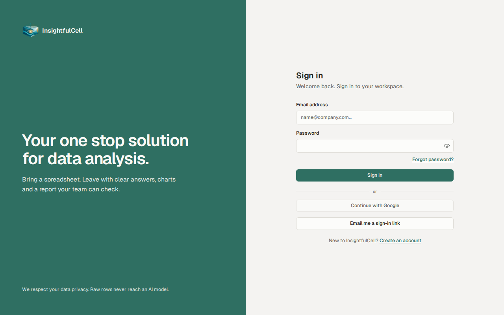 | Register 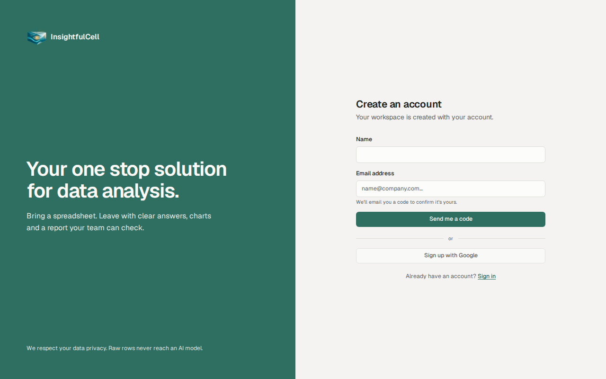 |
| Code step 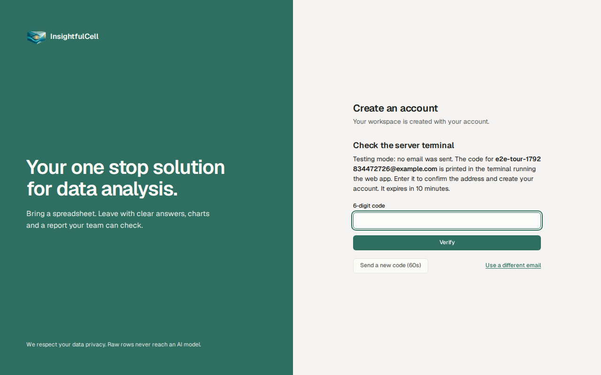 | Create a password 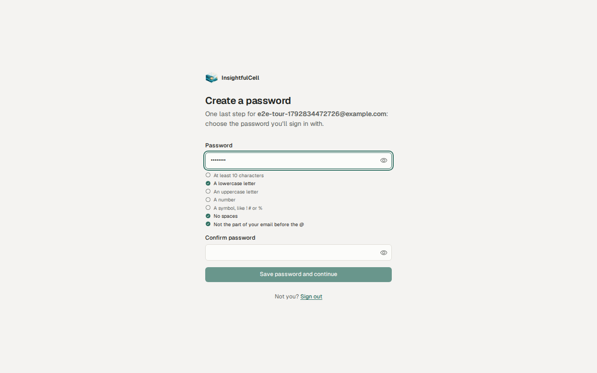 |
| Home 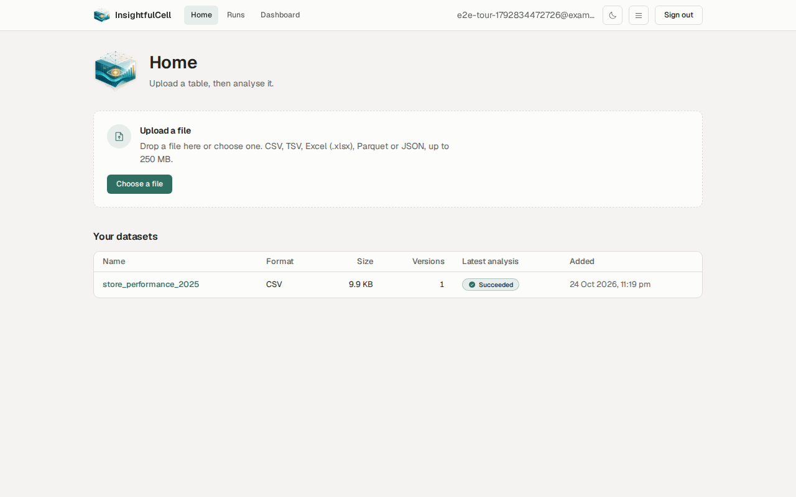 | Analysis running 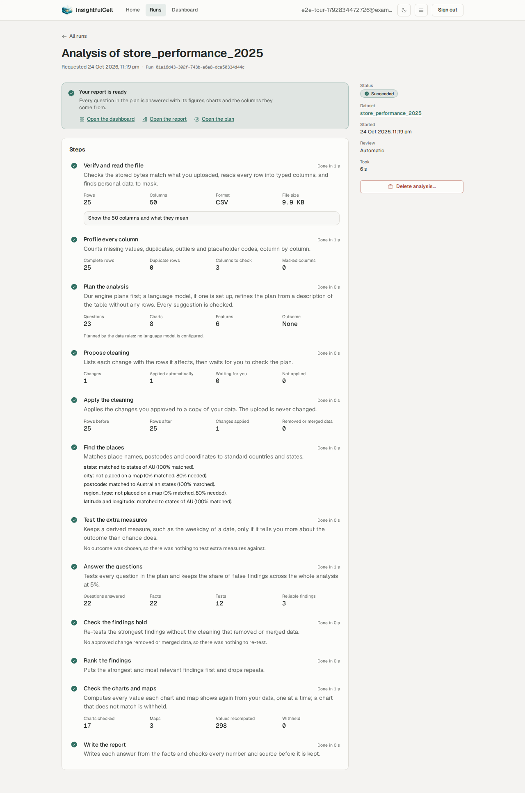 |
| Report  | Dashboard (dark) 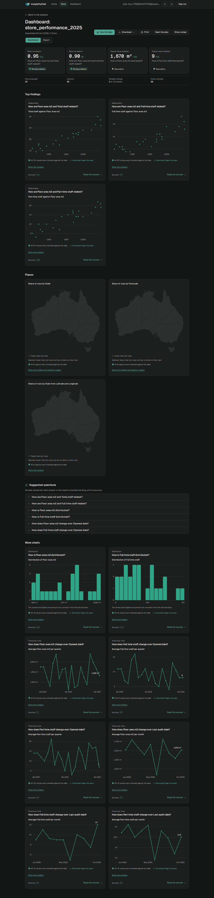 |
| Runs 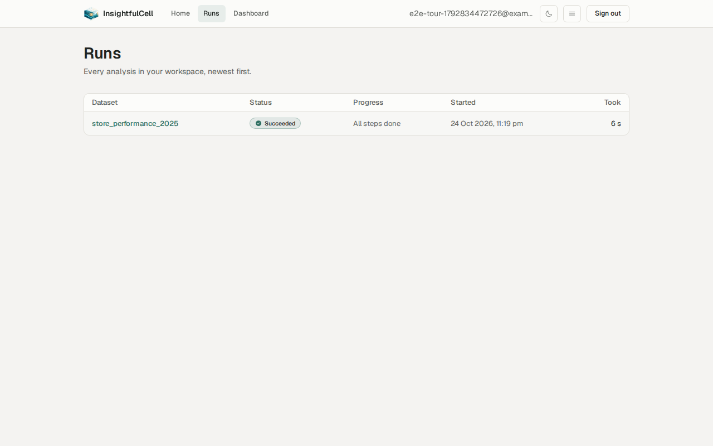 | Data & privacy 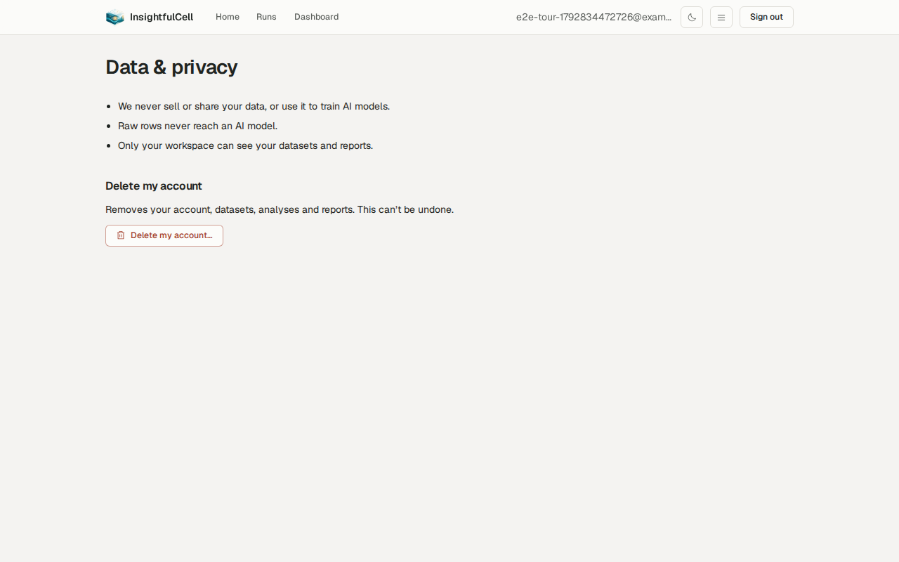 |
| Contact 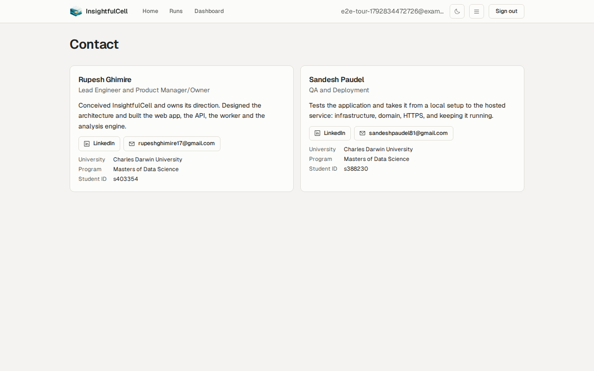 | About 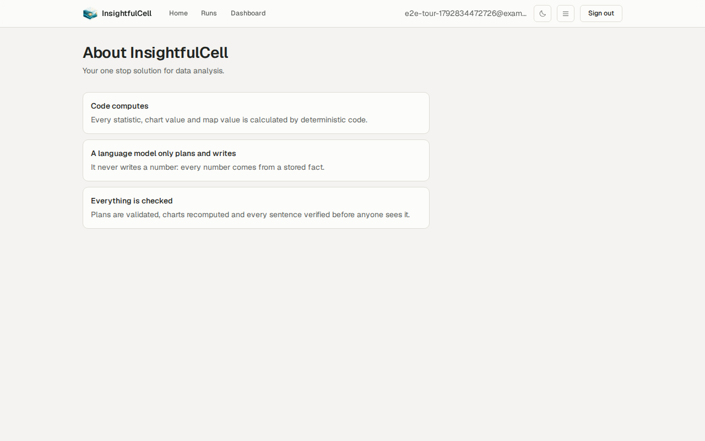 |
| Admin, locked 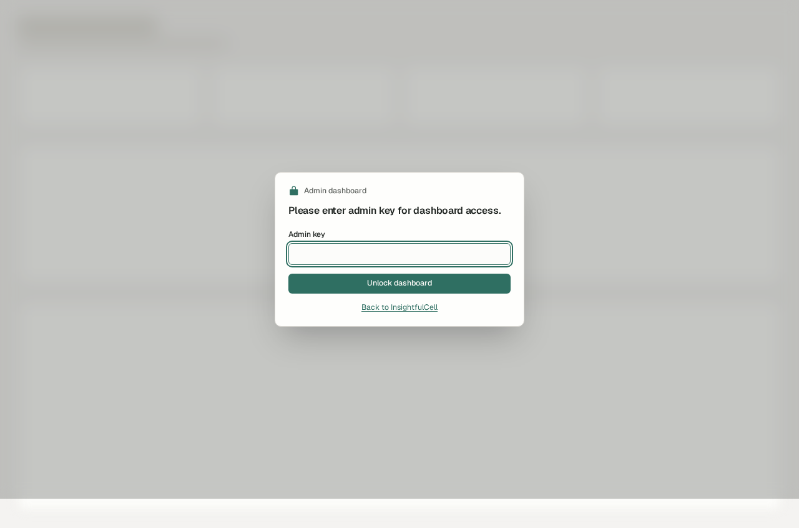 | Admin, unlocked 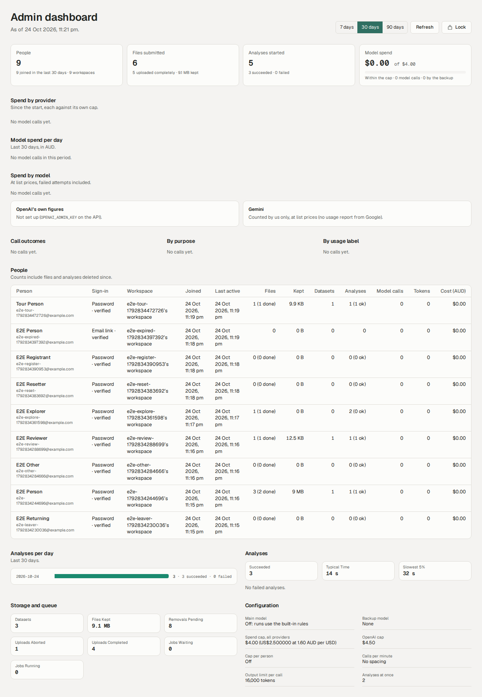 |
| Sign in, phone 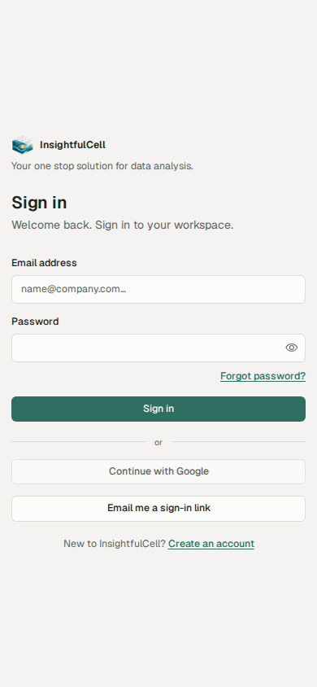 | Report, phone  |
